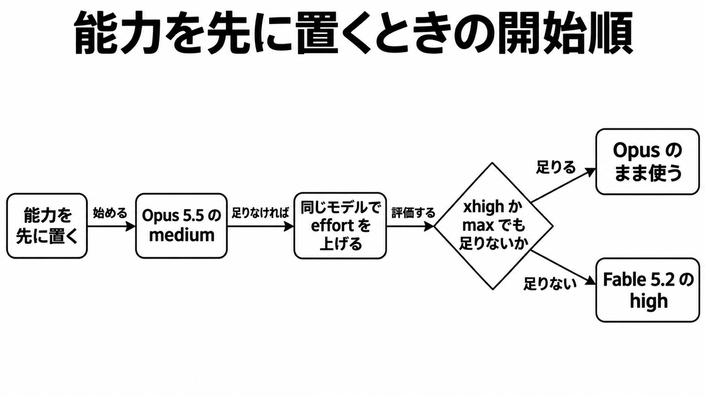

# ダイジェスト: Opus 5.5 の medium から始める

[元記事](../../../../../articles/which-claude-model-should-you-bu_20261110.md)

## ひとことで言うと

能力を先に置くなら、Opus 5.5 の medium から始めます。同じモデルで effort を上げ、xhigh か max でも足りないときだけ Fable 5.2 の high を試します。

## 核心ポイント

- 現行4モデルは、能力の低い順に Haiku 5.5、Sonnet 5.5、Opus 5.5、Fable 5.2 です。公式の始め方は、費用と遅延なら Haiku、能力なら Opus です。
- **effort**（仕事量。low、medium、high、xhigh、max）は thinking（回答前の推論）とは別です。API の既定は Haiku と Opus が medium、Sonnet と Fable が high、Claude Code はどれも medium です。
- 点数は自己測定で、問題集合と effort と試行数が違います。別の表の数字は並べて比べられません。
- 会話の途中で下位へ変えると、thinking はエラー無しで落ち、請求にも入力トークンにも入りません。入力と出力は、Opus が Fable の半分です。
- 途中で effort を変えると会話履歴のキャッシュが切れ、既定と同じ値なら切れません。Haiku だけ、キャッシュの読み書きを含む入力が 100,000 トークン超で単価が 5 倍です。

## メンタルモデル

足りなければ同じモデルで effort を上げ、xhigh か max でも足りないときだけ Fable 5.2 の high へ進みます。
FrontierCode 2.0 では max（45.7%）が xhigh（49.1%）より低く、Fable の max は既定にしません。

## 具体例

SWE-bench Pro の 478 問の部分集合では、Opus 5.5 の high が 95.3%、1件 $0.29 です。medium は約 2.5 点低く、費用は high の約 70% です。

## 適用と判断

向く場面:

- 能力を先に置く作業は Opus 5.5。
- 費用、遅延、単純処理は Haiku 5.5。
- 速度と能力なら Sonnet 5.5。

確認すること:

- 自分の課題で medium と high を少数回比べたか（2.5 点差は上の 478 問の値）。
- 途中の effort 変更で、会話履歴のキャッシュを作り直す見積もりか。
- Haiku の長文を、100,000 トークン以下の単価のまま見ていないか。
- Foundry（Claude Code の接続先）で opus のような短い名前を固定していなければ、無指定は旧 Sonnet 4.5 になる。
- ゼロデータ保持（入出力を保存しない契約）なら、Anthropic の承認が無い限り Fable は使えない。

## 限界・注意点

- 高い effort は持っていない知識や技能を与えません。この文は解説記事の但し書きです。知識の基準日は 2026年6月で、effort で動くとは書かれていません。
- 知識作業の Elo は Opus 1866、Fable 1831 です。DeepResearch Bench II では既定 effort で、Fable は Opus より費用 2.9 倍、1.9 点低く、採点できた 44 タスクです。
- Opus の high へ現行より前の Fable 5.1 を助言役（上位への助言）として足すと、370 件で 88.4% から 90.1%、費用は約 2.1 倍です。1.7 点はばらつきの端で、上積みは出にくいです。
- 安全分類器（危険な要求の検出）が拒むと、HTTP 200 のまま拒否です。このとき Claude Code は Fable と Opus 5.5 を、サイバーセキュリティなら旧 Opus 4.8、生物学なら旧 Opus 5 へ切り替え、そのまま続きます。戻すには /model です。Sonnet はサイバーセキュリティなら旧 Sonnet 5、生物学には切り替え先がありません。
- any と名前での強制は Sonnet、Opus、Fable でエラーです。auto と none は使えます。thinking を止める指定は、Haiku の high 以下を除いてエラーです。モデル変更でキャッシュが分かれるか、Haiku がツールの強制を拒むかは、公式に記載がありません。

## 参考

- 元記事: [which-claude-model-should-you-bu_20261110.md](../../../../../articles/which-claude-model-should-you-bu_20261110.md)
- [Which Claude model should you build with?](https://claude.dev/blog/which-claude-model-should-you-build-with/)
- [Choosing a model](https://platform.claude.com/docs/en/about-claude/models/choosing-a-model)
- [Pricing](https://platform.claude.com/docs/en/about-claude/pricing)
- [Preserved thinking](https://platform.claude.com/docs/en/build-with-claude/preserved-thinking)
