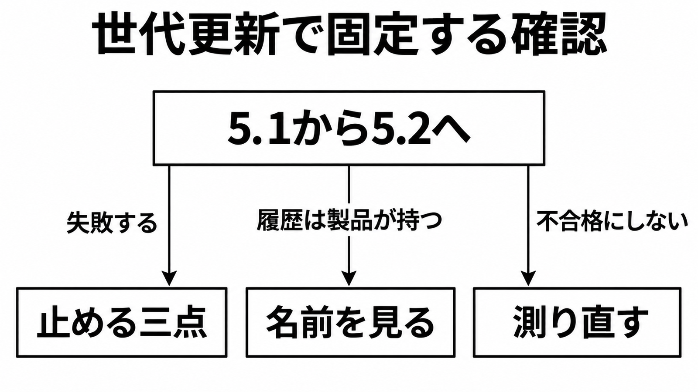

# ダイジェスト: 同じトークン量なら 0.8 倍、止めるのは三点

[元記事](../../../../../articles/claude-fable-5-2-anthropic-p1_20261111.md)

## ひとことで言うと

Fable 5.2 の標準料金は、トークン量が同じなら 5.1 の 0.8 倍です。止めるのは、自前履歴のターン間変更、Bedrock 以外の旧操作ツール、5.1 の相談役です。

## 核心ポイント

- Fable 5.2 と Mythos 5.2 は同じ基盤モデルで、Fable は一般に出し、Mythos はライフサイエンスとサイバーの審査プログラム経由です。標準料金はどちらも 100万トークンあたり入力 8 ドル、出力 40 ドルで、5.1 は入力 10 ドル、出力 50 ドルでした。
- トークン量が同じとき、入力も出力も標準料金は 5.1 の 0.8 倍です。**fast mode**（生成を最大 2.5 倍速くし、単価は入力 16 ドル、出力 80 ドル）と、コードを自分のものと名乗る一文は、この 2 割引きの外です。
- 失敗して止まるのは、自前の履歴でシステムプロンプト、ツール、過去のメッセージのどれかをターンのあいだで変えること、Bedrock 以外のコンピュータ操作の旧ツール（型名 `computer_20251124`）、作業側に残した 5.1 の**相談役**（相談されるモデル）です。
- 製品が会話履歴を持つ経路（Claude Code や claude.ai など）で見るのは、モデル名と相談役の組です。**effort** の点数、名乗る一文、小さいモデルへ渡すよう誘うプロンプトや外側の手順は、測り直す項目です。
- API の effort（思考の深さで、値は low、medium、high、xhigh、max）の既定は high で、5.1 から変わりません。claude.ai と Claude Code の既定は Medium で、effort を書かないテストは API の契約と同じではありません。

## メンタルモデル

測り直しは、不合格にはしません。

## 具体例

同じ CSV パーサを料金表で 1 回にすると、medium の 5.2 は 0.0761 ドル、5.1 は 0.0428 ドル、約 1.8 倍です。5.2 の出力にだけ思考があり、トークン量は同じではありません。

## 適用と判断

向く場面:

- トークン量が同じ前提で、5.1 から 5.2 の標準料金を予算に置く。
- 自前の履歴、旧操作ツール、相談役を、それぞれの 400 で試す。

確認すること:

- 自前の履歴で、システムプロンプト、ツール、過去のメッセージのどれかを、ターンのあいだで変えると 400 になるか。
- コンピュータ操作の旧ツールは呼び出し元だけで見て、Bedrock 以外は 400、Bedrock では旧ツールが残るか。
- 5.2 の作業側に 5.1 の相談役を付けると 400 になり、受け付けるのは Fable 5.2 か Mythos 5.2 だけか。
- 名乗る一文は、目的と作り方を任せるときだけ差分と出力トークンを見て、小さく変えたいときは入れないか。
- 小さいモデルへ渡すよう誘うプロンプトや外側の手順があるときだけ、渡す先の既定モデルを見るか。

## 限界・注意点

- 「タスクあたりおよそ半分の費用」は、コード変更が取り込まれる点数（High の Fable 5.2 が 45.3%、別モデル Opus 5.5 の最高が 45.5%）の初期テストでのタスク費用です。標準単価は Opus 5.5（入力 4 ドル、出力 20 ドル）の 2 倍で、自分の予算の半額には使いません。
- 出力が最大 30% 速い条件（呼び出し元、effort、初回トークンまでか、標本）は本文に無く、図だけにある可能性が残ります。料金表の別の約 30% はトークンが増える話で、5.1 も 5.2 も新しい側です。
- 5.2 の思考を読めないモデルへ戻すとリクエストは成功し、落とした入力は課金されません。次のターンは、費用と待ち時間が増え得ます。
- 名乗る一文を入れた小さい課題では出力が約 1.5 倍、出力単価 0.8 倍と掛けると出力費は 1.2 倍で、入力増は書かれておらず本番の保証ではありません。最後までやらせる文は、medium の記録済みセッションに足すと出力トークンが約 3 割増えます。
- 許可の無いゼロデータ保持では、API は 400 です。5.2 専用のレート制限の件数と、データの所在は、まだ数値がありません。

## 参考

- 元記事: [claude-fable-5-2-anthropic-p1_20261111.md](../../../../../articles/claude-fable-5-2-anthropic-p1_20261111.md)
- [Claude Fable 5.2 と Mythos 5.2 の発表](https://www.anthropic.com/claude-fable-and-mythos-5-2)
- [料金](https://platform.claude.com/docs/en/about-claude/pricing)
- [移行ガイド](https://platform.claude.com/docs/en/models/fable-5-2/migration-guide)
- [プロンプトガイド](https://platform.claude.com/docs/en/build-with-claude/prompt-engineering/prompting-claude-fable-5-2)
