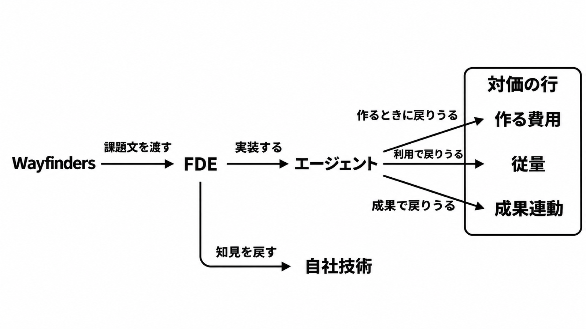

# ダイジェスト: 富士通FDEの対価は三つの行に分かれる

[元記事](../../../../../articles/fde-xtech-nikkei-atcl-nxt-p2_20261111.md)

## ひとことで言うと

富士通の FDE（Forward Deployed Engineer、顧客の現場で実装まで担う技術者）の対価は、利用料という一語にはなりません。作る費用、従量、成果連動に分かれ、成果が止んだ月に固定が残るかは別の行です。

## 核心ポイント

- Wayfinders（顧客の課題と成長機会を見つける役）が課題文を作り、FDE が実装と価値の検証を担い、知見を自社の技術へ戻します。2026年9月16日の IR Day（投資家向け説明会）は、この二つをスライド上で別の役として描いています。
- 人月（人数と期間を掛けて積む見積の単位）から、Outcome Base（成果に対する課金）と Usage Base（従量に対する課金）へ比重を移す、というのが同じ日の価格方針です。
- 約1,500億円は、2030年度の「FDE を起点としたビジネス創出」の売上試算です。Uvance（2030年度に売上 1.7兆円超を置く事業）全体の計画ではありません。
- Palantir Foundry（富士通が販売と提供の対象に名指しする製品）を使う公開仕様は、利用単位を FCU（その利用枠の単位）とし、数と期間を別紙に書きます。超過は、月末締めのその月の利用料です。
- 見積の品名が利用料でも、作るときの費用や、成果が止んだ月を含む七行へ分解してから署名します。分解できない行は、人月が名前だけ変わったものとして扱います。

## メンタルモデル

Wayfinders が課題文を渡し、FDE が業務上のエージェント（現場の業務に実装した AI エージェント）を作ります。図の三つの矢印は、そのエージェントから戻りうる対価です。知見は FDE から自社の技術へ戻ると、IR は書いています。

## 具体例

富士通の資料の物流では、機能開発などの行が「プロジェクト費＋利用料」、サービス提供の行が「利用料（マッチング収益）」です。マッチング収益は、成功報酬とは測る対象が違います。

## 適用と判断

向く場面:

- 「利用料」という品名の提案を、契約の行に分解してから署名する。
- 富士通の記事の無料の書き出しにある「2カ月でエージェント」と、別記事の「1〜5人」を、契約条件へ写さない。
- 成果が続く月だけ払う契約かを、その書き出しの一文から決めない。

確認すること:

- 課題文の確定者は Wayfinders、顧客、FDE のどれで、顧客側の確認と承認は誰が残すか。
- プロジェクト費、実装費、月額固定が、従量や成功報酬と別に残るか。
- 動いているときの費用は、超過、マッチング、段階別従量のどれか。
- 成果が止んだ月に固定が残るか。
- 理由を定めずに途中で解約できるか。

## 限界・注意点

- 約1,500億円は2026年9月16日の売上試算です。実績として使うのは、決算で FDE 起点の売上が区分して開示されたときだけです。
- 「2カ月でエージェント」は無料の書き出しの期間で、標準工期ではありません。
- 1〜5人と、既存職種の改名だけのエセ FDE は、別記事の無料の書き出しです。有料本文は未読で、富士通の契約条件には見つかりません。
- 成果が止んだ月に固定も利用料もゼロになる条文は、ここまでの公開資料にはありません。Hybrid 課金（固定部分と、事前に合意した成果指標に連動する料金の組み合わせ）は固定が残りうるので、その条文が示されたら止まった月の行を条文に合わせます。
- FCU の 1 単位が何を数えるかは、確認した条項になく、この仕様は FDE 案件のすべてではありません。理由を定めない途中解約ができないのは、その仕様が名指しする Data Mesh と Exceed です。

## 参考

- 元記事: [fde-xtech-nikkei-atcl-nxt-p2_20261111.md](../../../../../articles/fde-xtech-nikkei-atcl-nxt-p2_20261111.md)
- [日経クロステック「富士通の FDE」公開リード、2026年11月10日](https://xtech.nikkei.com/atcl/nxt/mag/nc/18/110400579/110400001/)
- [大西俊介氏、IR Day、2026年9月16日](https://resources.global.fujitsu/prir/2026/09/2026-IRDay-03-ja.pdf)
- [高橋美波氏、IR Day、2026年9月16日](https://resources.global.fujitsu/prir/2026/09/2026-IRDay-04-ja.pdf)
- [Fujitsu Data Intelligence Premium 仕様書 GC0052-EN001](https://global.fujitsu/-/media/Project/Fujitsu/Fujitsu-HQ/documents/terms-and-conditions/ss-fujitsu-data-intelligence-premium/v1/ss-fujitsu-data-intelligence-premium-en001.pdf)
