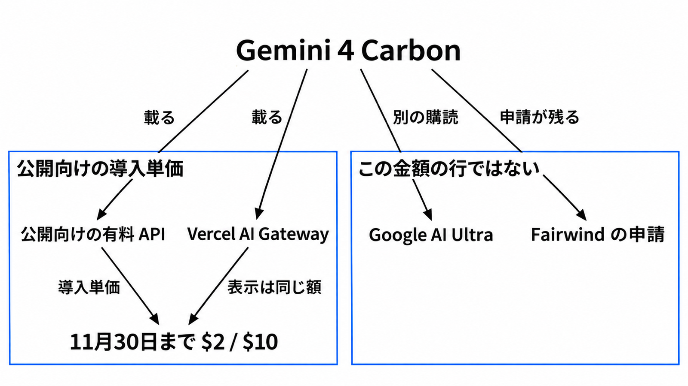

# ダイジェスト: Carbon の導入単価は 11月30日まで

[元記事](../../../../../articles/gemini-carbon-ai-gateway-p8_20261111.md)

## ひとことで言うと

公開向けの Gemini 4 Carbon（Gemini 4 のモデル）の導入単価は、2026年11月30日までです。
公開されただけでは、今使っているモデルは切り替えません。

## 核心ポイント

- 標準の行は Standard（選ばないときの料金区分）です。この行は、100万トークンあたり、2026年11月30日まで入力 $2、出力 $10、12月1日から入力 $4、出力 $20 です。
- AI Gateway（複数のモデルを一つの API から呼ぶ Vercel の経由面）の「50% off」は、表示が同じ $2 と $10 です。導入単価のさらに半分（$1 と $5）ではありません。
- 入り方は四つです。有料の API（標準は、開発者向け画面 AI Studio の Standard）と AI Gateway が公開向けの単価で、Google AI Ultra（有料の購読）のアプリと Fairwind（サイバー防御者向けの申請）はその行ではありません。
- Vertex（四つとは別の料金表）では、11月30日までの Global（料金表の地域区分）の印字が入力 $2、出力 $10 で、支出へクレジットを戻す注があるため請求書の額とは限りません。Cyber Permissive（その表の防御向けの行）は、11月30日までの割引行にありません。
- トークン単価は Argon（Carbon より先の Gemini 4）と同じでも、難しい問題では思考トークン（応答の前の推論。出力料金に入る）が、1 ターンでも Argon より多くなります。提供が広がっただけでは、実装の既定も防御の既定も動かしません。

## メンタルモデル

公開向けの API と AI Gateway は、11月30日まで同じ導入単価に載ります。
Ultra と Fairwind は、その金額の行ではありません。

## 具体例

4,096 トークン以上のプロンプトで、暗黙キャッシュ（自動で当たる入力）がヒットした分は、Standard の 11月30日まで $0.10 です。
同じ期限の Batch（非同期のまとめ処理）と Flex（柔軟な推論枠）は、入力 $1、出力 $5 です。
半額は、そのタブを選んだ価格で、Standard の請求が自動で半分になる意味ではありません。

## 適用と判断

向く場面:

- 公開 API か AI Gateway の予算を、11月30日までの導入単価で置く。
- 難しい問題で思考トークンが Argon より多い Carbon を使うときだけ、支出上限を付けて、今のモデルとは別に置く。

確認すること:

- 見る金額が Standard の行で、Batch や Flex の半額を既定にしていないか。
- 防御を動かす前に、Fairwind の条件と Cyber Permissive の単価を、その日の頁で読むか。
- 導入単価の最終日である 11月30日に、AI Studio の Standard、Gateway の表示、Vertex の Global（料金表の地域区分）とそれ以外を取り直すか。

## 限界・注意点

- Gateway が 12月1日以降に $4 と $20 を表示するかは、未確認です。
- Gateway の頁は最大出力を 1,000,000 と書き、API の同期上限は 65,536 です。経由したときの上限は、どちらなのか未確認です。
- 2026年11月11日の Fairwind のプログラム頁は、技術の節で Argon を名指し、頁の本文に Carbon の名はありません。公開 API が開いても、再配布を禁じる文はこの頁に残っています。
- 2026年11月13日から、Vertex では、Gemini 4 の生成結果が 32K トークンを超えてタイムアウトで失敗したとき、取り出せた分を課金します。11月30日の単価改定を置き換える日ではありません。
- 65,536 を超える出力には、サーバで続ける指定と、思考と出力の合計の上限を、両方書く必要があります。llm-gemini 0.36（コマンドからモデルを呼ぶ llm の Gemini 向けプラグイン）は、この続きを担いません。

## 参考

- 元記事: [Gemini 4 Carbonの提供面と、2026年11月30日までの公開単価](../../../../../articles/gemini-carbon-ai-gateway-p8_20261111.md)
- [Gemini 4 Carbon is now available](https://blog.google/innovation-and-ai/models-and-research/gemini-models/gemini-4-carbon-now-available/)（Google、2026年11月10日）
- [What's new in Gemini 4 Carbon](https://aistudio.google.com/docs/whats-new-gemini-4-carbon)
- [Google AI Studio pricing](https://aistudio.google.com/docs/pricing)
- [Vertex Model Garden pricing](https://cloud.google.com/model-garden/pricing)
- [Gemini 4 Carbon now available on AI Gateway](https://vercel.com/changelog/gemini-4-carbon-now-available-on-ai-gateway)
