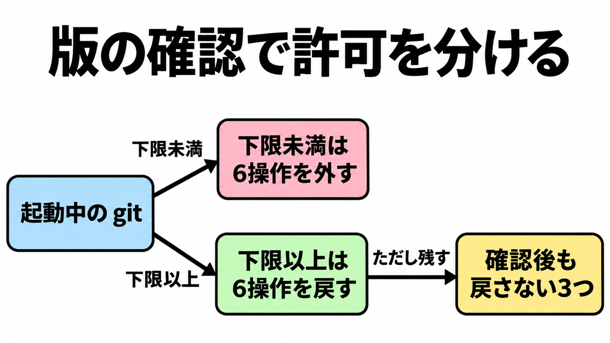

# ダイジェスト: 下限を確認するまで6操作は既定に置かない

[元記事](../../../../../articles/git-clone-import-github-open-p5_20261111.md)

## ひとことで言うと

起動している git が系列の下限以上と確認できるまで、6件の対象操作をエージェントの既定許可に置かない。コード実行と書かれているのは再帰 clone の1件だけ。

## 核心ポイント

- 止める6操作は、再帰 clone（`--recurse-submodules` でサブモジュールまで取る clone）、知らないサーバへの clone、署名が3個以上の tag の merge、三方マージ（共通祖先と両者の変更を重ねるマージ）、バイナリパッチの apply、fast-import（コマンド列からリポジトリを組み立てる操作）である。コード実行と書いているのは再帰 clone だけで、その tag の merge はスタックを壊す。
- 告知とリリースノートの下限は 2.56.1、2.55.1、2.54.1、2.53.1、2.52.1、2.51.3、2.50.2 である。2.51.0 から 2.51.2、2.50.0 と 2.50.1、2.49.1 以前は下限未満で、同じ日のセキュリティ告知の修正版 none は未修正の根拠にしない。
- 実バイナリが下限未満なら、この6操作をエージェントの既定から外し、CI は呼ぶ操作だけ外す。下限以上でも戻さないのは、信頼できない入力への `--allow-unsafe-features`（危険な機能を許すフラグ）、import 能力（fast-import の入力を渡す能力）の remote-helper（外部の転送実装）、git 以外の実装である。
- github.com と Enterprise Cloud は修正を配備済みで、手元の git とセルフホストの runner はその外である。GitHub Actions と Codespaces は、告知時点ではこれから受け取る。
- 下限未満でも、知っている GitHub への非再帰 clone は止める対象に入らない。

## メンタルモデル

左が起動中の git、右が下限未満と下限以上。
下限以上の先に、戻さない3つが残る。

## 具体例

信頼できない URL への再帰 clone は、パス名の長さが約 4 GiB 級だとコード実行になりうる。設定 `submodule.recurse` を true にしただけでは clone は再帰せず、その URL では版を確認するまで `--recurse-submodules` を付けない。

## 適用と判断

向く場面:

- エージェントが信頼できないリポジトリへ git を起動する許可を決めるとき。
- CI が上の6操作のどれを呼ぶか決めるとき。

確認すること:

- `git --version` が、2.51 系は 2.51.3 以上、2.50 系は 2.50.2 以上か。
- 下限未満の6操作を外し、戻さない3つは下限以上でも戻していないか。
- Actions と Codespaces の git を、GitHub が修正済みの版だと示すまで修正済みにしていないか。
- 修正版 none と 2.49.1 未満を採用せず、2.49.1 の三方マージの足し算が 32-bit のままであることを見ているか。

## 限界・注意点

- 知らないサーバへの clone で外へ書くと書いてあるのは、空リポジトリを protocol v2（参照名を広告する転送）で clone 後の、files backend（参照をファイルで置く方式）の参照更新である。空でないリポジトリで起きるかは告知の到達に無く、reftable（参照をテーブルにまとめる方式）で残るかは一次資料に無い。
- 三方マージの出力サイズの足し算が溢れると本文はヒープを壊すと書く。NVD と work item 814 は最低でもクラッシュで、ヒープ破壊はより悪い可能性だとする。
- バイナリパッチは、宣言した展開後サイズが 1023 MiB 以上のとき、範囲外読みでクラッシュしうる。fast-import は操作全体ではなく、入力中の3機能が任意のファイルを読むか、指定パスを作るか追記する。
- 知らないサーバで止めているのは clone で、fetch を同じ停止に含めるかは決まらない。libgit2、go-git、JGit は告知の対象外で、git の版番号では塞がらない。
- Actions と Codespaces がどのビルドで修正を受け取ったかは、告知本文から読めない。

## 参考

- 元記事: [git-clone-import-github-open-p5_20261111.md](../../../../../articles/git-clone-import-github-open-p5_20261111.md)
- [Git security vulnerabilities announced（GitHub Blog、2026-11-10）](https://github.blog/open-source/git/git-security-vulnerabilities-announced-7/)
- [Git RelNotes 2.56.1](https://raw.githubusercontent.com/git/git/v2.56.1/Documentation/RelNotes/2.56.1.adoc)
- [GHSA-vp2w-7xxj-jvxr（CVE-2026-111760）](https://github.com/git/git/security/advisories/GHSA-vp2w-7xxj-jvxr)
- [NVD CVE-2026-105437](https://services.nvd.nist.gov/rest/json/cves/2.0?cveId=CVE-2026-105437)
