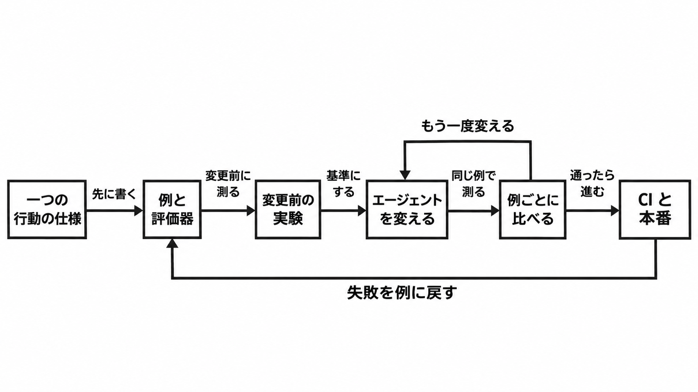

# ダイジェスト: 評価は先に、採否は例ごとに

[元記事](../../../../../articles/langchain-eval-driven-developmen_20261111.md)

## ひとことで言うと

Eval-Driven Development（EDD）は、エージェントの一つの行動を先に採点できる例にし、変更の前後を例ごとに比べる進め方です。成功条件を文章にできる行動に限り、そのまま採用します。

## 核心ポイント

- EDD は3段階です。何が良いかを定義し、評価を実装より先に書き、変更後は平均点だけでなく例ごとに比べます。
- 一度に扱うのは一つの行動で、仕様は、いつ動くか、何をするか、何をしないか、壊してはいけない既存の動作、の4つです。採点は最終回答だけでなく、途中の一つのステップ、ツール呼び出し、会話全体も対象です。
- テスト駆動開発と違い、同じ入力が同じ出力になるとは限りません。性質として書ける検査（期待するツール呼び出しや出力の形式）はコードの評価器（出力を採点する仕組み）で見て、一つの正解が無い文章の品質は、人の合否と一致するか確かめた LLM の評価器に任せます。
- LangChain の 2026-11-09 の記事は、2023 年頃からある評価の考え方を、一つの行動の仕様と LangSmith（エージェントの観測と評価のサービス）に当てた説明で、**効果の測定結果ではありません**。
- AI Evals FAQ は、失敗を事前に列挙しきれないので、実装より先に評価器を書くやり方にたいてい否と答えます。成功条件が最初から文章になっている行動だけ評価を先に書き、失敗の種類をまだ書けないときは実行記録を読んでから評価器を足します。

## メンタルモデル

変更前の実験（変える前に同じ例で走らせた結果）を基準に、前後を比べます。通った変更は、テストが落ちることで止める検査と、本番の採点へ進みます。人が確認した失敗だけを、次の例に戻します。

## 具体例

ドキュメント検索とウェブ検索を持つエージェントに、チケット作成を足した作例です。VPN の設定手順を聞かれただけなのにチケットを作り、チケット作成ツールの説明を狭めたら用意した例は全部通りました。平均点が上がったとは書かれていますが、その数値は本文にありません。

## 適用と判断

向く場面:

- 成功条件をすでに文章にできる、一つの行動を直す。
- 期待するツール呼び出しや出力の形式を、テストが落ちることで変更を止めたい。
- 同じ例の差を画面に残したい、テスト結果を LangSmith の例の集合へ同期したい、本番の実行記録を採点したい、のどれかなら LangSmith を足す。

確認すること:

- 次に直す行動は一つで、4つの仕様を数行で書いたか。
- その行動の例を10件ほど作り、コードで落ちる検査を一つ付け、変更の前に一度走らせたか。
- 調整に使った例とは別に、取り置き（held-out）の例を置いたか。
- 平均点の改善が 2〜3 ポイントなら、1 回の実行で採否を決めていないか。
- 本番の採点を付けるなら、採点の対象にした実行記録が既定で 180 日保持に上がる費用を入れ、見合わなければ採点する割合を絞ったか（公式の例は 10%）。

## 限界・注意点

- 同じエージェント向けベンチマークでも、1回の試行で正解した割合は実行のたびに 2.2〜6.0 ポイント動きます。公開研究の値で、2〜3 ポイントの改善を 1 回の実行で採用しない理由になります。
- 取り置きの問題と意味が重なるデータで訓練すると、取り置きの精度が最大 22 ポイント上がりうると、別の公開研究が書いています。モデル訓練の研究なので、取り置きだけでは未知の入力の証明になりません。
- LangSmith では、experiment（一つの版の結果）の実行記録は 180 日保持が既定で、新しい本番採点は対象の実行記録を既定で同じ保持に上げます（外せます）。無課金で月 5,000 件の実行記録を超えるか、1 時間あたりの送信量の上限（例は 500MB）に達すると、拒否されることがあります。
- 小さな例の集合での全問正解は、過学習の合図になりうると記事自身が警告しています。
- IssueBench は 15 タスクで、精度も再現率も本文に無く、実データをどこで混ぜたかは読み取れません。

## 参考

- 元記事: [langchain-eval-driven-developmen_20261111.md](../../../../../articles/langchain-eval-driven-developmen_20261111.md)
- [What Is Eval-Driven Development?](https://www.langchain.com/blog/what-is-eval-driven-development)
- [AI Evals FAQ](https://hamel.dev/blog/posts/evals-faq/)
- [Demystifying evals for AI agents](https://www.anthropic.com/engineering/demystifying-evals-for-ai-agents)
- [LangSmith usage and billing](https://docs.langchain.com/langsmith/usage-and-billing)
