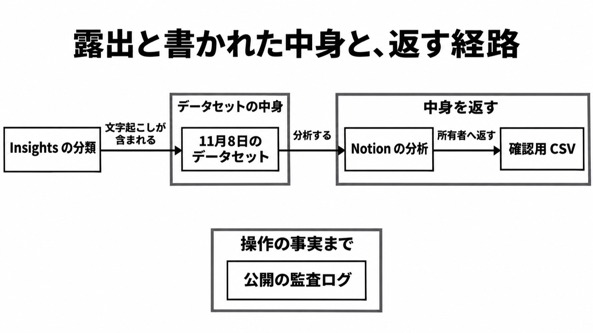

# ダイジェスト: 委託先に残ったのは Insights の文字起こし

[元記事](../../../../../articles/notion-fireworks-ai-notion-p4_20261111.md)

## ひとことで言うと

Notion が露出したと書いた中身は、Insights（自分の AI 利用状況を見る機能）用のチャット文字起こしです。
その文言は事後の確認用 CSV が返し、公開の監査ログは操作の事実までです。

## 核心ポイント

- 11月8日のデータセットにはその文字起こしがあり、他の Notion 機能とワークスペース内のその他のデータは影響なし、と公式は書きます。影響を受けた可能性があるのはワークスペースの 1% 未満で、件数は公開文に無い。
- 影響を受けたワークスペースの大半は unattributable（発言者とワークスペースのラベルが無く、ツール呼び出しの結果も無い）だった、とアドバイザリは書きます。全員にラベルが無かった、という意味ではありません。
- Fireworks（今回の委託先）への経路は、Insights の分類、推論、LEAP（新しい AI の試験に自らデータを出す参加）の過去の学習として並びます。11月8日のデータセットの中身として書かれているのは文字起こしです。
- 中身をワークスペースへ戻すのは、確認用 CSV です。監査ログの公開説明は操作の事実までで、説明に無い項目がエクスポートにも無いとは断定しません。
- オープンウェイトモデルを Fireworks 経由で提供するのも止まっています。この語の定義は通知に無く、通知が指すのは製品内で Fireworks 経由で出していたモデルです。

## メンタルモデル

## 具体例

| セット | 公式が書いた中身 | 読み方 |
|---|---|---|
| 11月2日夜 | 合成テストデータ。顧客データは含まれない | その夜に渡されたセットについての文 |
| 11月8日確定 | Insights 用のチャット文字起こし | 11月2日夜の文では閉じない |

## 適用と判断

向く場面:

- 今回は、連絡があれば確認画面を開き、そこで渡されたデータを露出として扱います（モバイルからは開けず、英語は desktop browser、日本語はデスクトップアプリか Web ブラウザです）。
- 次の契約は、サブプロセッサ（処理を委ねる第三者）の目的を「LLM の提供」の一行で受けず、分類、推論、学習のどれに何を出すかを経路ごとに書かせます。
- 自社のエージェントは、操作ログ（開いたか、有効にしたか）と送付台帳（経路、委託先、出した種別）を分けます。

確認すること:

- 所有者と本人の両方に連絡が無いことを監査の終了にせず、ヘルプの「今は対応不要」とアドバイザリの「未特定で後から連絡し得る」を両方読んでいるか。
- 開始日と終了日が公式に無いので自社の日付で対象外にせず、Notion AI へ貼った資格情報は日付で切らず替えているか。
- 「Enterprise なら委託先に残らない」と読まず、ZDR（応答を作るためだけに処理し、その後は残さない）のモデルは残さず、ZDR でないモデルは所有者の opt-in（明示してオン）のときだけ限られた期間保持し得て、Free、Plus、Business は 30 日以内に削除、と分けているか。
- 11月2日の「顧客データは含まれない」を、11月8日の最終データセットへ広げていないか。
- 注釈付き CSV（露出していないユーザー紐付けを後から足したもの）を、Enterprise でメンバーを管理している所有者だけと読み、他プランは本人分、管理が無い Enterprise はヘルプに未記載、と分けているか。

## 限界・注意点

- チャット期間の開始日と終了日は公式にありません。Fireworks の 10月6日と 10月23日から 25日は、資格情報と開発マシンの話で、チャット期間ではありません。
- Fireworks の製品名 Inference、Training SDK、Nexus（中身は更新に無い）への影響未検出は、オープンウェイト推論のプロンプトがデータセットに無い証明ではありません。
- LEAP の学習データが 11月8日のデータセットに含まれるかは、どちらとも書かれていません。
- Notion が Fireworks の Response API（既定でプロンプトと応答を最大 30 日保持し得る。保持はその API に限る）を使ったかは、公開文にありません。
- 現行 DPA（処理条件の追加契約）の通知期限は未確認です。廃止版の数字は使いません。

## 参考

- 元記事: [notion-fireworks-ai-notion-p4_20261111.md](../../../../../articles/notion-fireworks-ai-notion-p4_20261111.md)
- [Notion, "Fireworks AI incident"（更新 November 10, 2026）](https://www.notion.com/security/advisories/security-incident-involving-a-third-party-ai-vendor)
- [Notion Help, "Notice about the Fireworks AI incident"](https://www.notion.com/help/security-incident-involving-a-third-party-ai-vendor)
- [Fireworks AI, "Update on October 2026 security incident"](https://fireworks.ai/security/bulletins/october-2026-security-incident-update)
- [Notion Help, "Notion AI security & privacy practices"](https://www.notion.com/help/notion-ai-security-practices)
