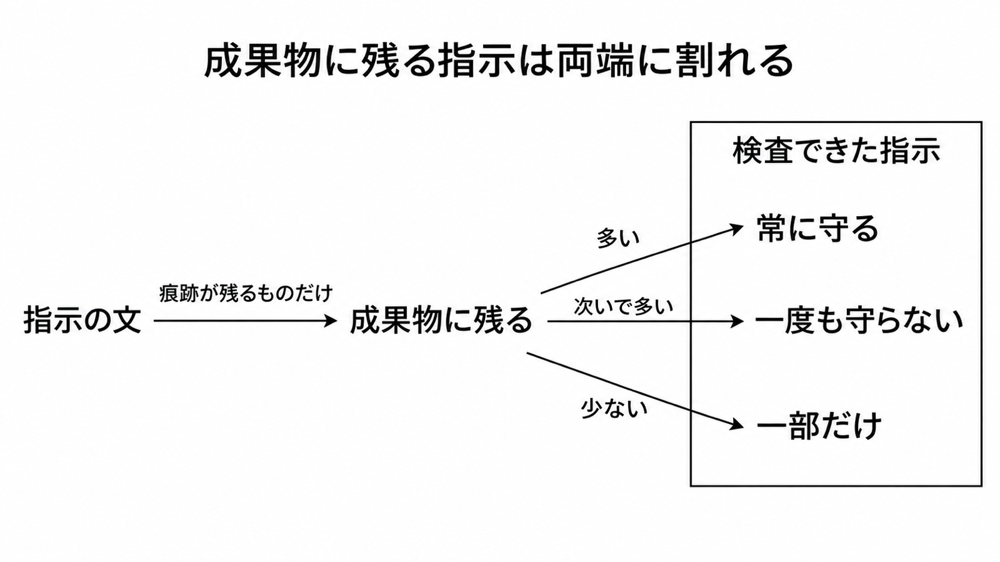

# ダイジェスト: AGENTS.mdなどの指示は成果物検査で守られるものと守られないものに分かれる

[元記事](../../../../../articles/agents-md-arxiv-abs-2611-13709-p6_20261112.md)

## ひとことで言うと

AGENTS.md のような指示ファイル（プロジェクトの指示を渡すファイル）では、変更されたファイルに痕跡が残る文だけが検査でき、測れた指示の多くは両端に割れ、中間は少ない。

## 核心ポイント

- 測定の単位はファイル全体ではなく、ファイルに直接書いてあり、実行でき、変更されたファイルから判定できる指示 1 件である。遵守は、その指示が対象とする種類のファイルを変更したコミットに対して、検査スクリプト（守ったかをファイルから返すプログラム）が返す真偽で、従う気だったかは見ない。
- 候補文 14,902 件のうち測れたのは 2,053 件（13.8%）だけである。その 2,053 件では平均 59.8%、中央値 100%、常に守る 54.4%、一度も守らない 37.3%、中間 8.3% で、平均はコミットの遵守率ではなく、中央値 100% は両端への割れから来る。
- 全標本では、コードに残る規約（中央値 100%、平均 63.6%）が、テストの有無や実行（平均 49.2%、中央値 37.5%）より高い。対象のコミットを 3 件以上、5 件以上に限っても有意なのはこの対だけで、開発手順（コミット形式やブランチのような作業手順）の対比較は有意差が消え、フックや CI へすべて移す根拠にはしない。
- 同じ再計算のあと残る差は、Copilot が Claude Code より高い一点で、カテゴリとリポジトリは統制されていない。製品の優劣としては読めない。
- 生成した検査の抜き取り 94 件では、71.3% だけが指示を正しく実装していた。

## メンタルモデル

指示の文のうち、変更されたファイルに痕跡が残るものだけが検査対象になる。右の枠は、検査できた指示が常に守る側、一度も守らない側、その中間に割れることを示す。

## 具体例

「プルリクエストの前に lint を実行する」は実行できても、コミット後のファイルだけでは実行したかが残らないことがある。コードに残る規約は検査の対象になり、コミット形式やブランチはフックか CI の方が向く可能性がある。

## 適用と判断

向く場面:

- 変更されたファイルに痕跡が残る命令を、指示ファイルに 1 振る舞いずつ残す。
- テストや lint の合否、禁止、秘密、権限、人の承認を、CI か、操作の前に止めるフックか、permissions.deny（指定した操作を、モデルの判断より前に拒否する設定）で止める。
- エージェントを替えたあと、同じ指示の遵守を測り直す。

確認すること:

- その文は、変更されたファイルに痕跡が残って、合格と不合格が決まるか。
- 生成した検査を、人が見てから CI に入れるか。
- Claude が 200 行未満で遵守が落ちにくいと書く CLAUDE.md（Claude 用の指示ファイル）と、Codex が 32 KiB 超を切る読み込み合計とを、超えていないか。
- リポジトリの概要を足して成功率が上がる前提にせず、コストの増減は対象のリポジトリで測るか。

## 限界・注意点

- 指示が無いコミットとの比較はなく、指示ファイルが遵守を上げたとは言えない。公開 GitHub と Copilot、Claude Code、Codex の 3 つに限る。
- 観測可能（変更されたファイルを見て遵守を判定できる、というラベル）の精度は 85.0% で、そのラベルが付いた 6,552 件は上限である。
- 例を条件にしてしまう誤りは遵守率を下げる。対象外のコミットへの根拠なしの真（採用した検査スクリプト 4,123 件の 62.3%）は適用の絞り込みが除き、二つのどちらが大きいかは未定量である。
- 検査の対象になるかは、変更されたファイルに痕跡が残るかで決まる。検査そのものは変更前と変更後の全文を見るので、触る前からあった違反を、そのコミットの非遵守に数えることがある。
- 論文が示す再計算用の一式は 2026-11-12 に開けず、数値の再計算はできない。フックと CI が 37.3% を減らすか、割れの原因、別の環境で同じになるかは分かっていない。

## 参考

- 元記事: [AGENTS.mdなどの指示は成果物検査で守られるものと守られないものに分かれる](../../../../../articles/agents-md-arxiv-abs-2611-13709-p6_20261112.md)
- Voria, Kashiwa, Catolino, Palomba. Do They Do as They Are Told? arXiv:2611.13709v1（2026-11-10）. <https://arxiv.org/html/2611.13709>
- Claude Code memory. <https://code.claude.com/docs/en/memory>
- Codex AGENTS.md. <https://learn.chatgpt.com/docs/agent-configuration/agents-md>
- Gloaguen ら arXiv:2602.11988v3. <https://arxiv.org/html/2602.11988>
- Lulla ら arXiv:2601.20404v2. <https://arxiv.org/abs/2601.20404>
