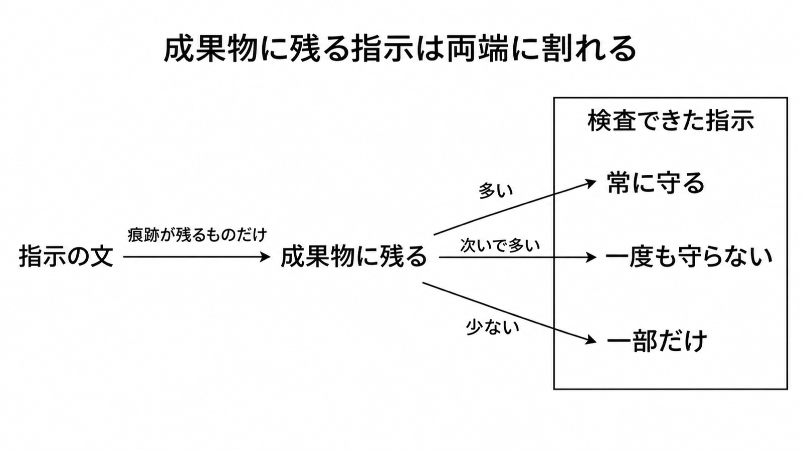

# ダイジェスト: AGENTS.mdなどの指示は成果物検査で守られるものと守られないものに分かれる

[元記事](../../../../../articles/agents-md-arxiv-abs-2611-13709-p6_20261112.md)

## ひとことで言うと

成果物から検査できた AGENTS.md などの指示は、常に守られるか一度も守られないかに割れます。

## 核心ポイント

- 測定の単位は指示 1 件です。自動生成した検査プログラムが、コミットで変更されたファイルから守ったかを判定します。
- 指示ファイルから取り出した文のうち、測れたのは 13.8% です。
- 測れた指示の 54.4% は、検査したコミットすべてで守られ、37.3% は一度も守られません。
- コードに残る規約の指示は、テストの有無や実行の指示より守られます。

## メンタルモデル

左から右へ読みます。矢印の「多い」「少ない」は、右の枠の 3 つに入る指示の量です。

## 具体例

「プルリクエストの前に lint を実行する」は、実行してもコミット後のファイルに痕跡が残らないことがあります。痕跡が残らない指示は、検査の対象になりません。

## 適用と判断

向く場面:

- 指示ファイルの文を、守られたか検査できる形に書き直すときです。
- 禁止事項や承認が要る操作を、CI や権限設定で止めるときです。

確認すること:

- その文は、成果物だけで合格と不合格が決まるか。
- エージェントを替えたあと、遵守を測り直したか。

## 限界・注意点

- 指示が無いコミットと比べていないため、守られたのが指示ファイルの効果とは言えません。
- 対象は公開 GitHub と、Copilot・Claude Code・Codex の 3 つです。
- Copilot の遵守率は Claude Code より高いですが、製品の優劣としては読めません。
- 抜き取りでは、自動生成した検査の 28.7% が指示を正しく実装していませんでした。
- CI などの外の仕組みが、守られない指示を実際に減らすかは分かっていません。

## 参考

- 元記事: [AGENTS.mdなどの指示は成果物検査で守られるものと守られないものに分かれる](../../../../../articles/agents-md-arxiv-abs-2611-13709-p6_20261112.md)
- Voria, Kashiwa, Catolino, Palomba. Do They Do as They Are Told? arXiv:2611.13709v1（2026-11-10）. <https://arxiv.org/html/2611.13709>
- Claude Code memory. <https://code.claude.com/docs/en/memory>
- Codex AGENTS.md. <https://learn.chatgpt.com/docs/agent-configuration/agents-md>
- Gloaguen ら arXiv:2602.11988v3. <https://arxiv.org/html/2602.11988>
- Lulla ら arXiv:2601.20404v2. <https://arxiv.org/abs/2601.20404>
