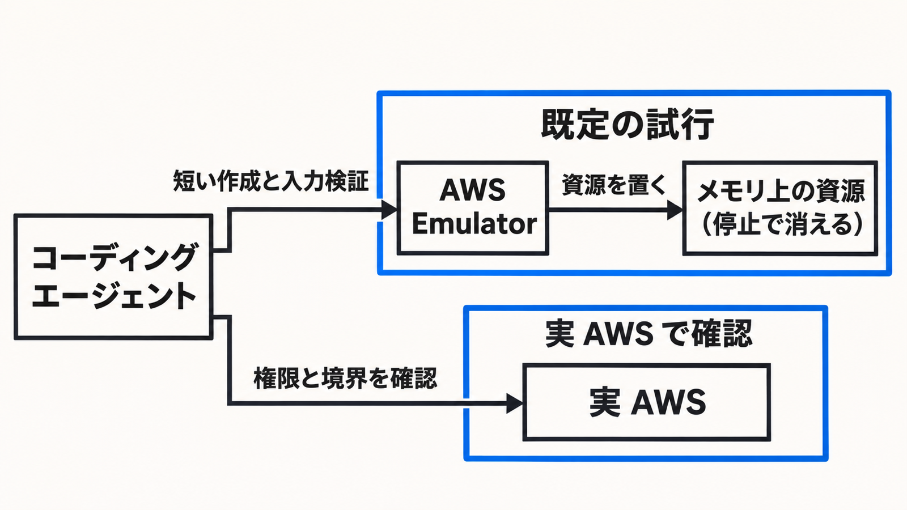

# ダイジェスト: 短い試行はローカル、権限は実 AWS

[元記事](../../../../../articles/aws-emulator-devops-aws-amazon-p3_20261112.md)

## ひとことで言うと

AWS Emulator は、コーディングエージェントの資源作成をローカルで受けます。権限は実 AWS で確かめます。

## 核心ポイント

- AWS Emulator は、CLI と SDK の呼び出しを自分のマシンや CI で受けます。資源はメモリに置き、停止すると消えます。
- 未実装の操作は HTTP 501 で落ちます。応答が AWS と揃う度合いは、サービスと機能でばらつきます。
- 権限の評価は AWS と同じではありません。AWS が拒否する要求が成功しえます。
- アカウントやリージョンを変えても、状態は分かれません。
- エミュレータが動かす Lambda の関数コードは、実行ユーザーの権限でファイルを読み書きできます。エージェントへの指示文にも書いておきます。

## メンタルモデル

上の枠はエージェントがふだん使う試行先、下の枠は実 AWS での確認です。図の「境界」は、アカウントとリージョンの分離を指します。

## 具体例

エミュレータは、呼び出し元の Account を `000000000000` と返します。起動直後に `aws sts get-caller-identity` で確かめます。違う値なら実 AWS を呼んでいるので、作業を止めます。

## 適用と判断

向く場面:

- バケットやテーブルを作り、入力の検証エラーを見る短い試行に向きます。

確認すること:

- 使う操作は、応答を AWS と比べる公開試験の一覧 (GitHub) にあるか。
- 使う操作の大半は、501 を返さずに通るか。
- 権限のテストは、実 AWS で確かめているか。

## 限界・注意点

- 向け先は環境変数 `AWS_ENDPOINT_URL` で決めます。これが無いシェルは、見つかった資格情報で実 AWS を呼びます。
- テレメトリは既定でオンです。操作の回数や OS の種類などを送り、要求と応答の中身は送りません。
- 長時間の起動と負荷は未検証です。
- 本番データは入れません。テストデータだけを使います。
- 公開試験がカバーしない挙動は、正しく動いていても未確認です。実 AWS で確かめます。

## 参考

- 元記事: [aws-emulator-devops-aws-amazon-p3_20261112.md](../../../../../articles/aws-emulator-devops-aws-amazon-p3_20261112.md)
- [What is AWS Emulator?](https://docs.aws.amazon.com/emulator/latest/userguide/what-is-service.html)
- [Security in AWS Emulator](https://docs.aws.amazon.com/emulator/latest/userguide/security.html)
- [Pointing your AWS SDK at AWS Emulator](https://docs.aws.amazon.com/emulator/latest/userguide/point-sdk-to-emulator.html)
- [Test your applications against AWS locally with AWS Emulator](https://aws.amazon.com/blogs/aws/test-your-applications-against-aws-locally-with-aws-emulator/)
