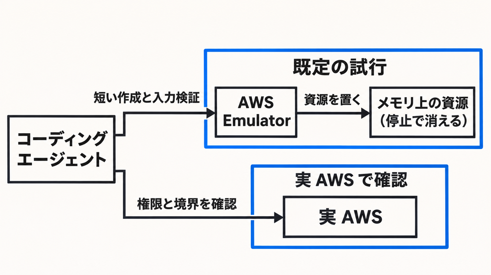

# ダイジェスト: 短い試行はローカル、権限は実 AWS

[元記事](../../../../../articles/aws-emulator-devops-aws-amazon-p3_20261112.md)

## ひとことで言うと

AWS Emulator は、CLI と SDK の呼び出しを自分のマシンや CI で受けます。短い作成と入力検証はここを既定にし、権限とアカウントやリージョンの分離は実 AWS に残します。

## 核心ポイント

- AWS Emulator（自分のマシンや CI で AWS の API を受けるプログラム）は、既定で `127.0.0.1:9297` の HTTPS を待ち、資源をそのプロセスのメモリに置きます。停止すると消え、アカウントも追加料金も要りません。
- 未実装の操作は HTTP 501（未実装）で落ちます。実装した操作は AWS と同じ結果を目指しますが、忠実度（応答が AWS と揃う度合い）はサービスと機能でばらつきます。
- AWS が拒否する要求は成功しえ、許可する要求は失敗しえます。起動のたびにエミュレータが書く署名用の鍵で署名した要求は拒否しません。
- Lambda（渡した関数を動かすサービス）の関数コードは、マシンから隔離されません。実行しているユーザーの権限で、ファイルを読み書きできます。
- アカウントやリージョンを変えても、状態は分かれません。権限、その分離、試験がカバーしない挙動、本番前の通し確認は実 AWS に残します。

## メンタルモデル

図の左は CLI と SDK で呼ぶコーディングエージェント、図の境界はアカウントやリージョンの分離です。エミュレータ上で権限拒否や分離が成功したように見えても、実 AWS の結果ではありません。

## 具体例

起動直後に、今の認証情報のアカウントを返す `aws sts get-caller-identity` を実行します。返る Account が `000000000000` でなければ、エミュレータではなく実 AWS を呼んでいます。そのときは止めます。

## 適用と判断

向く場面:

- S3 のバケットや、DynamoDB（キーで項目を持つデータベース）のテーブルを作り、不正な名前が AWS と同じ検証エラーになるかを見て、次の修正へ進む。
- 呼び出しの形は CLI と SDK のまま、向ける先だけをローカルにする。

確認すること:

- 使う操作が、公開されている忠実度の試験一覧（各試験が呼ぶサービスと操作）にあるか。
- 上の Account が `000000000000` か。
- 権限の成否を、どのサービスでもエミュレータの成功で終えていないか。
- 仕事が最初から権限の上限やアカウント間の拒否を見ることなら、エミュレータを既定にしていないか。
- 使う操作の大半が 501 か、使う版の試験で失敗が集まっているなら最初から実 AWS にし、サービス全体の合格の割合だけでは判断していないか。

## 限界・注意点

- 製品ページは同じ結果と同じエラー、ネットワークの無いサンドボックスとも書きますが、User Guide（公式の利用ガイド）で応答がいちばん近いのは資源の作成・参照・更新・削除・一覧です。テレメトリ（操作の回数、結果の区分、OS、SDK の種類などを送り、要求と応答の中身は送らない）は既定でオンです。
- `AWS_ENDPOINT_URL` が無いと、見つかった資格情報で実 AWS を呼びます。`AWS_ENDPOINT_URL` に localhost を使うと、JavaScript、Java、Go はバケット名をホスト名に載せ、エミュレータは受けないので、値は `127.0.0.1` にします。
- User Guide の分数は、そのサービスの試験件数のうちの合格件数で、同じ版どうしだけで比べます。1 つの割合を忠実度とは呼ばず、公開ファイルの 1 行が公式の 1 試験かは未確認です。
- データプレーン（サービスの主機能。例はオブジェクトの取得と保存）を、一括で実 AWS に置けとは User Guide は書いていません。
- KMS（暗号鍵を管理するサービス）の鍵ポリシーと S3 のバケットポリシーは見ません。IAM（認証と権限）のユーザーとロールを違うやり方で評価するのは一部のサービスだけで、サービス名も日本語版との差も未確認です。

## 参考

- 元記事: [aws-emulator-devops-aws-amazon-p3_20261112.md](../../../../../articles/aws-emulator-devops-aws-amazon-p3_20261112.md)
- [What is AWS Emulator?](https://docs.aws.amazon.com/emulator/latest/userguide/what-is-service.html)
- [Security in AWS Emulator](https://docs.aws.amazon.com/emulator/latest/userguide/security.html)
- [Pointing your AWS SDK at AWS Emulator](https://docs.aws.amazon.com/emulator/latest/userguide/point-sdk-to-emulator.html)
- [Test your applications against AWS locally with AWS Emulator](https://aws.amazon.com/blogs/aws/test-your-applications-against-aws-locally-with-aws-emulator/)
