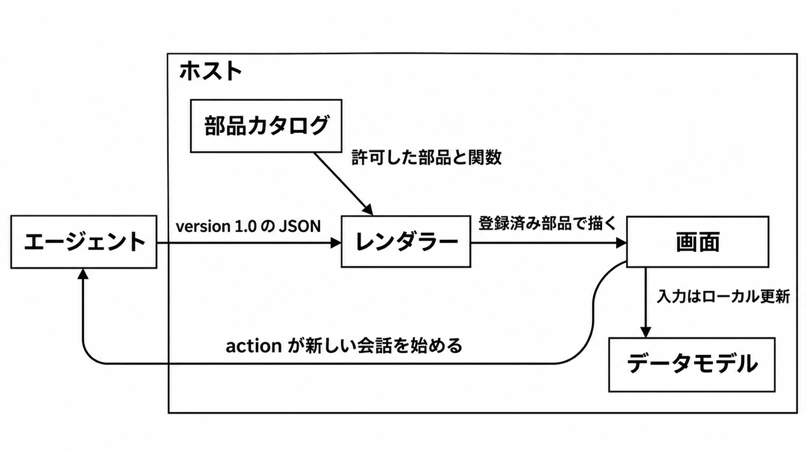

# ダイジェスト: A2UI 1.0は許可した部品だけで描く

[元記事](../../../../../articles/google-a2ui-1-0-ui-developers-p2_20261112.md)

## ひとことで言うと

A2UI 1.0 は、ホスト（画面を持つアプリ）が許可した部品名の JSON だけで画面を組むプロトコルです。
公式表で v1.0 が Stable な実装は React、Lit、Angular です。

## 核心ポイント

- エージェントは見た目を描きません。カタログ（許可した部品と関数の名前の契約）に無い部品は描かず、対応カタログの一覧へはフォールバックしません。
- 文字入力はデータモデル（送る前の画面の値）を更新するだけで、新しい会話は action（新しい会話ターンを始めるメッセージ）だけが始めます。ホストに実装が無い関数は、action とは別のメッセージで実行を依頼します。
- 公式表の v1.0 が Stable なのは React、Lit、Angular だけです。Flutter と SwiftUI は Alpha、Jetpack Compose 向けの A2UI 1.0 は予定で、Stable と同じ完成度にはしません。
- protocolVersion（カタログがどのプロトコル版かを示す欄）を省略すると既定は 0.9 で、1.0 では明示が必須です。部品 id は UAX #31（識別子に使える文字の規則）に従い、ハイフンや数字始まりは無効です。
- コードをメッセージに載せないのは配送の形で、action には利用者が入れた値が載ります。sendDataModel を有効にしても打鍵のたびには送らず、次にレンダラーが出すメッセージに画面全体の値が、その画面を作ったエージェントへ付きます。

## メンタルモデル

エージェントは部品名の JSON をレンダラー（ホストの部品で JSON を描く実装）へ渡します。
レンダラーはカタログにある部品だけで画面を描きます。
打鍵はデータモデルに留まり、新しい会話は action が始めます。

## 具体例

| 操作 | 扱い | 会話 |
|---|---|---|
| 文字入力、スライダー、チェック | データモデルを更新する | その操作だけでは新しいターンを始めない |
| 確認や送信のボタン | action（名前は任意の文字列） | 新しい会話ターンを始める |
| URL を開く、入力を検証する | action に置く関数呼び出し | 実装があれば会話を始めない。無ければ action とは別に実行を依頼する |

告知の「確認するまで何も送られない」は物語で、確認、編集、送信という予約名はありません。

## 適用と判断

向く場面:

- 自前のデザインシステムを持ち、未知の部品を拒否できるホストなら、A2UI 1.0 を画面のメッセージの形にします。
- 最初に繋ぐレンダラーを React、Lit、Angular のいずれかに限る。
- 部品を置けない遠隔画面は A2UI にせず、A2UI の原稿が示す iframe（外の画面の埋め込み）にします。

確認すること:

- protocolVersion は 1.0 とし、0.9 のカタログは 1.0 の実行環境へ載せません。
- 部品 id は UAX #31（例: submit_btn）にし、公式例のハイフンはコピーしません。
- sendDataModel は、画面全体の値をその画面を作ったエージェントへ渡してよいときだけ有効にします。
- URL を開く操作と Markdown の画像とリンクは、javascript: を拒むだけでは足りず、許可する接続先を仕様とは別に決めます。
- Web の共有パッケージ @a2ui/web_core は、javascript: を拒む 0.10.2 以降を使います。

## 限界・注意点

- 告知では、Gemini が今日描くプロトコルは 0.9.1 です。非 Web と Gemini Enterprise（企業向けの Gemini）の 1.0 は先送りで、公開情報だけでは後者がどのビルドで完了するかは決まっていません。
- 公式例のハイフン付き id は、スキーマ検証だけでは落とせません。
- レンダラー同士を同じ意味の部品の木に揃える試験は、未完です。
- その原稿の公開ページは、2026-11-12 時点で確認できていません。
- Atlassian と Bloomberg の本番のプロトコル版は、この記事にはありません。

## 参考

- 元記事: [A2UI 1.0はホストが許可した部品だけでエージェント画面を描く](../../../../../articles/google-a2ui-1-0-ui-developers-p2_20261112.md)
- [A2UI Protocol v1.0](https://a2ui.org/specification/v1.0-a2ui/)
- [A2UI 1.0 の告知](https://developers.googleblog.com/a2ui-10-build-delightful-fast-reliable-agentic-experiences/)（Google Developers Blog、2026-11-11）
- [Renderer support](https://github.com/a2ui-project/a2ui/blob/main/docs/public/reference/renderers.md)
- [GHSA-72qq-p3r5-f7wq](https://github.com/a2ui-project/a2ui/security/advisories/GHSA-72qq-p3r5-f7wq)（openUrl の javascript:。修正は 0.10.2 以降）
