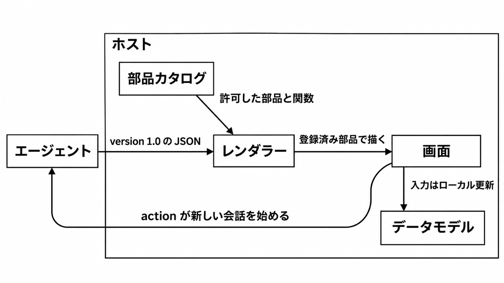

# ダイジェスト: A2UI 1.0は許可した部品だけで描く

[元記事](../../../../../articles/google-a2ui-1-0-ui-developers-p2_20261112.md)

## ひとことで言うと

A2UI 1.0 は、ホスト（画面を持つアプリ）が許可した部品だけでエージェントの画面を描くプロトコルです。

## 核心ポイント

- エージェントは部品の名前を JSON で渡します。レンダラー（ホスト側の描画実装）は、カタログ（許可した部品と関数の契約）にある部品だけで描きます。
- 新しい会話ターンを始めるのは、ボタンなどが送る action です。
- 公式表で v1.0 が Stable なのは React、Lit、Angular です。Flutter と SwiftUI は Alpha です。
- action は利用者の入力値をエージェントへ運びます。エージェントが LLM なら、モデルの入力になり得ます。

## メンタルモデル

左のエージェントから右の画面へ、矢印をたどります。
画面から出る 2 本の矢印が、入力の行き先の違いです。

## 具体例

| 操作 | 扱い | エージェントへの送信 |
|---|---|---|
| 文字入力、スライダー | 画面内の値を更新します | その操作だけでは送りません |
| 確認や送信のボタン | action を送ります | 送り、新しい会話ターンを始めます |
| URL を開く、入力を検証する | レンダラーがその場で処理します | レンダラーが処理できれば送りません |

## 適用と判断

向く場面:

- 自前のデザインシステムを持つホストに向きます。

確認すること:

- 未知の部品をホストが拒否できますか。
- カタログ JSON に protocolVersion 1.0 がありますか。
- 仕様が無効とするハイフンを、部品に付ける id に使っていませんか。
- リンクと画像の接続先を、ホスト側で許可制にしましたか。
- npm の @a2ui/web_core は修正版 0.10.2 以降ですか。

## 限界・注意点

- ホストアプリの外にある画面は対象外です。iframe が候補です。
- レンダラー間で意味を揃える適合試験は未完です。

## 参考

- 元記事: [A2UI 1.0はホストが許可した部品だけでエージェント画面を描く](../../../../../articles/google-a2ui-1-0-ui-developers-p2_20261112.md)
- [A2UI Protocol v1.0](https://a2ui.org/specification/v1.0-a2ui/)
- [A2UI 1.0 の告知](https://developers.googleblog.com/a2ui-10-build-delightful-fast-reliable-agentic-experiences/)（Google Developers Blog、2026-11-11）
- [Renderer support](https://github.com/a2ui-project/a2ui/blob/main/docs/public/reference/renderers.md)
- [GHSA-72qq-p3r5-f7wq](https://github.com/a2ui-project/a2ui/security/advisories/GHSA-72qq-p3r5-f7wq)（openUrl の javascript:。修正は 0.10.2 以降）
