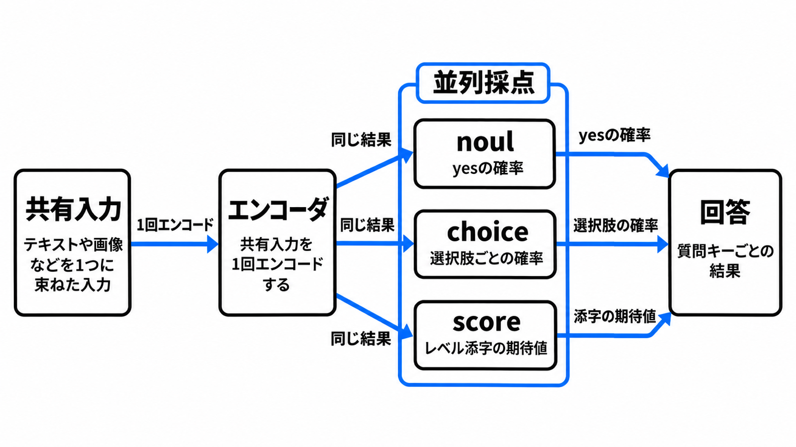

# ダイジェスト: 型を限った質問を数値で返す Decisions API

[元記事](../../../../../articles/google-gemini-decisions-api-p1_20261112.md)

## ひとことで言うと

Gemini Decisions API は、1 つの入力に型を限った質問を当て、確率などの数値を返します。

## 核心ポイント

- 質問の型は **noul**、**choice**、**score** の 3 つです。noul は yes/no で yes の確率、choice は選択肢ごとの確率を返します。
- score は、呼び出し側が低い順に並べたレベルに 0 から番号を振り、その期待値を返します。
- 1 回に最大 1,000 問を 1 つの共有入力へ当てます。質問どうしは互いの答えを見ません。
- 課金は入力トークンだけで、有料枠は 100 万トークンあたり 0.10 米ドルです。共有入力は質問数によらず 1 回だけ数えます。
- noul の確率は 0.01 から 0.99 に収まります。0.99 を超えることを実行条件にすると、一度も通りません。

## メンタルモデル

中央の 3 つの質問は、同じエンコード結果から別々に採点されます。

## 具体例

元記事の例は、注文と顧客の文を共有入力にして、3 問を同時に聞きます。

| 質問 | 型 | 使い方 |
|---|---|---|
| ハードウェアの欠陥か | noul | yes の確率が 0.9 超かを見ます |
| 次の対応はどれか | choice | 最も高い選択肢の確率が 0.6 超かを見ます |
| 解約しそうな度合い | score | 4 レベルで応答例は 2.99。分岐には使いません |

上の 2 つを両方満たせば選ばれた対応を実行し、満たさなければ人へ回します。

## 適用と判断

向く場面:

- ツールやキューへの振り分けを確率で決めます。
- 多数のポリシー条文を共有入力へ同時に当てます。
- 候補を固定のルーブリックで並べます。

確認すること:

- 高リスクの行動に、人か第二の検査を残しましたか。
- 閾値を自前のラベル付きデータで決めましたか。
- どの選択肢にも合わない入力への受け皿がありますか。

## 限界・注意点

- テキスト生成、関数呼び出し、キャッシュ、Batch API は対応外です。
- 質問を増やしても遅延がほぼ平坦、という公開ブログの記述は 100 問・16K トークンまでです。それを超える範囲については記載がありません。
- 公開ガイドは確率を「校正済み」と呼びます。ただし、実測の頻度と合うとは書いていません。

## 参考

- 元記事: [型を限った質問を数値で返す Gemini Decisions API](../../../../../articles/google-gemini-decisions-api-p1_20261112.md)
- [Decisions API](https://aistudio.google.com/docs/decisions-api)
- [Gemini Decision 1](https://aistudio.google.com/docs/models/gemini-decision-1)
- [Gemini Decisions API: Fast, calibrated multimodal decisions](https://blog.google/innovation-and-ai/technology/developers-tools/gemini-decisions-api/)（Google、2026-11-11）
- [Pricing の Gemini Decision 節](https://aistudio.google.com/docs/pricing)
