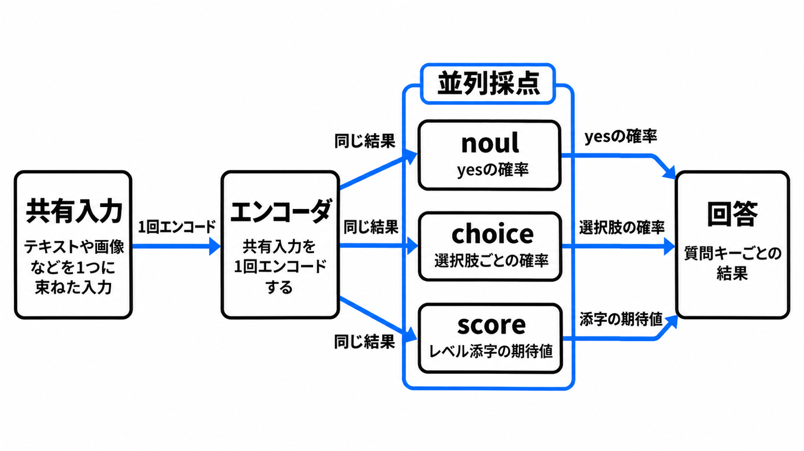

# ダイジェスト: 型を限った質問を数値で返す Decisions API

[元記事](../../../../../articles/google-gemini-decisions-api-p1_20261112.md)

## ひとことで言うと

Gemini Decisions API は、共有入力へ、答えの型を限った質問を当て、文章の代わりに数値を返します。
返すのは、確率か、段階の添字の期待値です。
実行の閾値は、呼び出し側が持ちます。

## 核心ポイント

- **noul** は yes の確率、**choice** は合計 1 の選択肢の確率、**score** は低い方から高い方へ並べたレベルの添字の期待値です。1 回に 1 件から 1,000 件を同時に評価しますが、質問は互いの答えを見ず、結果を対応づける名前はモデルに渡らないので、質問文は instructions（モデルへ渡す質問文）に書きます。
- 生成が必要な要約、抽出、引数付きのツール呼び出しは、Interactions API（文章生成を担う API）に残します。
- **confidence**（その問いで一番有力な側の確率そのもの）は、noul では yes と no の大きい方、choice と score では最大の確率です。noul は 0.01 から 0.99 に収まり、その confidence も 0.99 が上限なので、0.99 より上を noul の実行条件にすると一度も真になりません。
- 有料枠の入力は、媒体を問わず 100 万トークンあたり 0.10 米ドルで、出力トークンは常に 0 です。共有入力は質問数にかかわらず 1 回だけ数え、キャッシュが無いので、同じ入力の再送はそのたびに全入力を数えます。
- モデルは gemini-decision-1 です。呼べる公開面は Gemini Developer API の v1beta（この API の版のパス）だけで、2026 年 11 月以降の SDK の既定は v1 なので、呼び出し側で v1beta を指定します。

## メンタルモデル

入力の安全フィルタを通過したときだけ、共有入力を 1 回エンコードし、noul、choice、score を並列に採点します。
通過しなければ、回答ではなくエラーが返ります。
質問の結果は互いに渡りません。

## 具体例

ガイドの例は、同じ注文と顧客の文へ、欠陥か（noul）、次の対応（choice）、解約の段階（score）を同時に聞きます。
応答例は、欠陥の確率 0.94、次の対応で一番高い選択肢の確率 0.76、解約は 4 段階（添字 0 から 3）の期待値 2.99 です。
ガイドがこの例で使う 0.9 と 0.6 は、欠陥の確率と次の対応の confidence への分岐例であり、業務の閾値ではありません。

## 適用と判断

向く場面:

- 同じ入力を、ツール、キュー、モデル、エージェントのどれへ渡すかを、確率で切る。
- 多数のポリシー条文を、1 つの入力へ同時に当てる。
- 候補を、score の段階で並べる。

確認すること:

- 払戻しと権限の変更は、確率が高くても人または第二の検査に残しているか。
- ツール実行の許可を、一番有力な選択肢や noul の 0.99 だけでは渡さず、閾値、保留、差し戻しをアプリ側に持っているか。
- 閾値を、正解を付けた自前の呼び出しで、偽陽性と偽陰性の損失から決めているか。
- choice はどれにも合わなくても確率を配るので、confidence の閾値か、別の noul による範囲確認か、説明付きの受け皿を持っているか。

## 限界・注意点

- **校正済み**は、公開ガイドがこの確率につける呼び方です。0.01 から 0.99 の区間とも、実測の頻度との対応とも、ガイドは結びつけて書いていません。
- テキスト生成、関数呼び出し、キャッシュ、まとめて後から処理する Batch API は、対応外です。
- レイテンシがほぼ平坦という記述の条件は、マルチモーダル入力、質問 1 件から 100 件、コンテキスト 16K トークンまでです。上限の 1,000 件と 262,144 トークンへ延ばす記述は、API ガイドにありません。
- Vertex AI のエンドポイントと、gemini-decision-1 の画像や動画の解像度ごとのトークン数は、2026-11-12 時点の公開ガイドにありません。安全フィルタが共有入力だけを見るのか、各質問の文も見るのかは、未確認です。

## 参考

- 元記事: [型を限った質問を数値で返す Gemini Decisions API](../../../../../articles/google-gemini-decisions-api-p1_20261112.md)
- [Decisions API](https://aistudio.google.com/docs/decisions-api)
- [Gemini Decision 1](https://aistudio.google.com/docs/models/gemini-decision-1)
- [Gemini Decisions API: Fast, calibrated multimodal decisions](https://blog.google/innovation-and-ai/technology/developers-tools/gemini-decisions-api/)（Google、2026-11-11）
- [Pricing の Gemini Decision 節](https://aistudio.google.com/docs/pricing)
