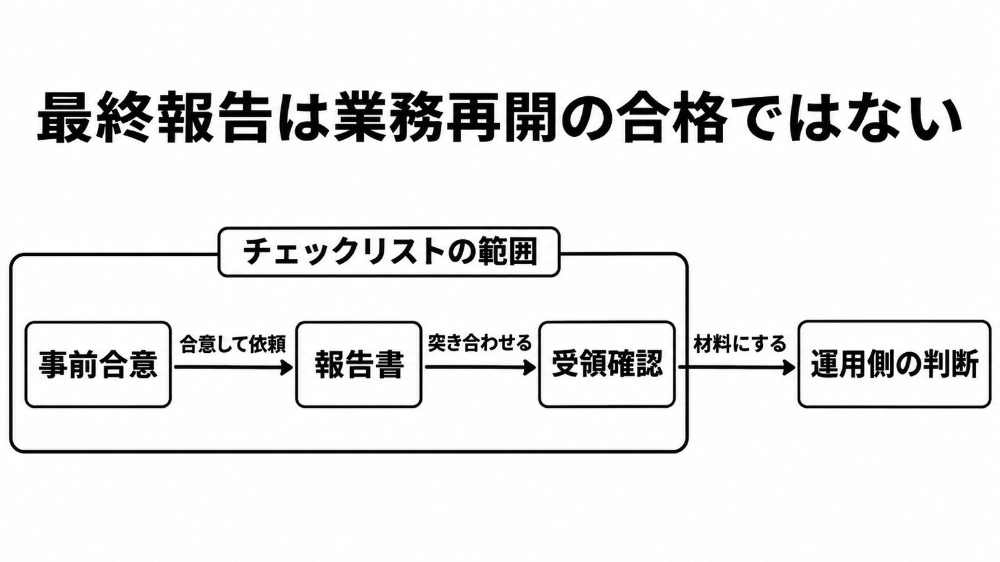

# ダイジェスト: 最終報告は業務再開の合格ではない

[元記事](../../../../../articles/jpcert-cc-jpcert-or-jp-ir-p9_20261112.md)

## ひとことで言うと

JPCERT/CCのチェックリストは、ネットワーク侵害の外部調査で、調査を頼む組織と報告書の書き手が同じ項目を確認する補助である。最終報告を受け取っても、業務を戻す合格にはならない。

## 核心ポイント

- 2026年11月11日の案内は公開ページで、依頼側（調査を頼む組織）、作成側（報告書を書く担当者）、架空のサンプルへ進む。対象は、マルウェア感染などをともなうネットワーク侵害である。
- 報告書を求めるなら、概要、初期侵入の原因、影響範囲、被害内容、再発防止の5章を最低限含める。
- 表紙の最終報告や変更履歴の最終版は、未解明が無いことや、評価が今後変わらないことを意味しない。
- 復旧を先にすると証拠が失われることがあり、調査を先にすると再開が遅れるので、説明を受けた依頼側が先を決めるか、決めない旨を残す。チェックリストは、対応を終えたとみなす合格条件も、業務を戻す欄も持たない。
- 項目を全部満たしても、調査の技術的な品質、範囲と手法の妥当性、証拠の十分さ、再発防止の妥当性の評価にはならない。個人データの漏えい等の法令上の期限は、調査の納期とは別である。

## メンタルモデル

左から事前合意、報告書、受領確認が、チェックリストの範囲である。
受領確認は、運用する側の判断へ材料を渡す。
その矢印は、業務を戻してよいという合格ではない。

## 具体例

個人情報保護委員会のガイドライン（通則編）では、個人データの漏えい等のうち報告を求める事態について、速報の目安は概ね3日から5日以内、確報は30日以内、不正の目的で行われたおそれがあるときは確報が60日以内である。この日数は調査開始前の合意項目に無く、すべてのインシデント調査の納期でもない。チェックリスト上の速報は委託先から依頼側への途中報告で、委員会への速報とは別であり、調査の納期と委員会の期限は同じ日付にしない。

## 適用と判断

向く場面:

- ネットワーク侵害の調査を外部へ頼む前に、委託範囲を記録へ残すとき。
- 報告書を受け取り、抜け、矛盾、根拠、残るリスクを見るとき。
- 個人データの漏えい等の法令報告がある事案で、調査の納期と委員会への速報・確報を分けて置くとき。

確認すること:

- 目的と結果の用途、報告書の要否、対象と手法、判断できない事項、5つの章、頻度と期限と納品後の問い合わせ、共有先を記録し、復旧と調査のどちらを先にするかは、業務・証拠保全・調査期間の説明を受けて決めるか、決めない旨を残したか。
- 報告書に、目的ごとの答えか答えられない理由、対象外、根拠、残るリスクがあるか。
- 最終報告の版で運用を戻さず、判断できないシステムが残っていないか、再構築の前に証拠を保全しているか、対応策の業務影響を把握しているか、していないならその旨と実施時の影響があるかを見たか。
- サンプルの章立てを、内部不正の報告書の型にしていないか。
- 技術的な妥当性に懸念が残るとき、リストの完了をもって足りたとせず、別の専門家への相談を検討しているか。

## 限界・注意点

- 内部不正では、公開ページは使えない項目があるとし、作成側は必要な項目が変わる類型の一つとし、サンプル冒頭は目的も記載も大きく異なるとする。
- 契約範囲外やログ欠損を制約として書く作成側の項は推奨だが、依頼側の受領確認は対象外と調べられなかったことを見させる。初期侵入を断定できない理由は、作成側では必須である。
- 公開ページは表示-継承 4.0 と書くが、その要約ページはライセンスではなく法的意味を持たないと書いている。2026年11月12日時点でライセンスファイルは無く、社内の改変版を委託先へ渡すことが頒布に当たるかは決着していない。
- サイバー保険の約款、業法ごとの報告期限、委託契約の責任制限と運用再開の重なりは、この公開物からは決まらない。既存の契約とチェックリストのどちらが優先するかも、公開ページは定めていない。

## 参考

- 元記事: [jpcert-cc-jpcert-or-jp-ir-p9_20261112.md](../../../../../articles/jpcert-cc-jpcert-or-jp-ir-p9_20261112.md)
- [JPCERT/CC「インシデント調査報告書チェックリスト公開のお知らせ」（最終更新 2026-11-11）](https://www.jpcert.or.jp/ir_report_checklist_20261111.html)
- [公開ページ](https://jpcertcc.github.io/ir_report_checklist/)
- [依頼側チェックリスト](https://github.com/JPCERTCC/ir_report_checklist/blob/main/checklist_for_customer.md)
- [個人情報保護委員会「ガイドライン（通則編）」](https://www.ppc.go.jp/personalinfo/legal/guidelines_tsusoku/)
