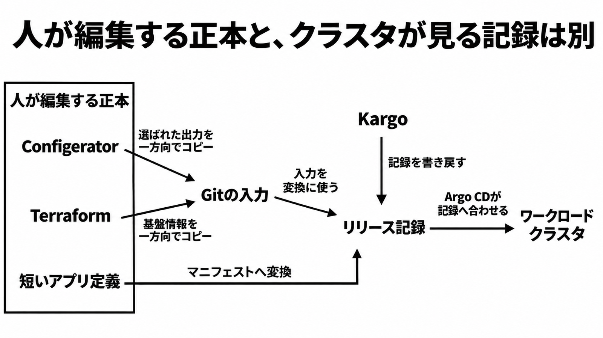

# ダイジェスト: 人が編集する正本と、クラスタが見る記録は別

[元記事](../../../../../articles/meta-ai-100-terraform-gitops-p8_20261112.md)

## ひとことで言うと

Meta の Cloud Foundation（AI 用 Kubernetes の運用担当）は、Terraform に基盤を残し、アプリの記録を Git に置きます。クラスタはその記録へ合わせます。

## 核心ポイント

- 以前は、Helm の values（配備時の設定値）の 1 行も共有の Terraform workspace（状態と適用の作業単位）に乗り、止まった 1 本の Helm 配備が他の数十本を遅らせ得た、と事例は書いています。ドライバ（製品名は非公開）や values の定常更新は 4 時間超で、クラウド資源が変わらない values の 1 行も同じ経路でした。
- いまの分担は三つです。Terraform がクラウド資源とクラスタを持ち、Kargo（環境間の昇格ツール）が望ましいリリースの完全な記録を Git に書き戻し、Argo CD（その記録へクラスタを引き戻す役）が合わせます。
- 人が編集するのは、Configerator（Meta の実行時設定のシステム）、Terraform、短いアプリ定義（配備先と検証チェックを書いた入力）です。選ばれた設定と基盤情報は、Git の入力（コピー先であり、クラスタが見る記録ではない）へ一方向でコピーし、コピー元へは戻しません。
- 4 時間超が数分になった、という記述は測定条件の無い自己申告です。数分も、クラスタの外に置いて複数クラスタを見る共有の Argo CD も、採用の理由にしません。
- 経路を分ける既定は、アプリの更新頻度が基盤と違い、共有 workspace が無関係なリリースを待たせているときだけです。エンドポイント、IAM、ノードプールを同じリリースで要する変更は、Terraform の適用と Argo CD の合わせを同じ昇格に残します。

## メンタルモデル

枠の中が、人が編集する正本です。プラットフォーム（短い定義と Git の入力をマニフェストへ変える側）の変換結果と、Kargo が書き戻す完全な記録は、同じリリース記録に入ります。Argo CD はその記録へクラスタを合わせます。

## 具体例

クラウド資源が変わらない Helm の values の 1 行が、以前は設定の生成、社内のビルドと検証、Terraform の plan、昇格を通っていました。

## 適用と判断

向く場面:

- 昇格の承認者は、その昇格の検証と soak（次へ進む前に置いておく時間）を飛ばせる例外口なので、Terraform を変える人とは分けます。
- ドライバを昇格するとき、GPU が割り当てられることを検証チェックに書きたい。

確認すること:

- 直近の Helm 変更が、Terraform の列で何を待っていたかを 1 件取り出したか。
- 成功条件を、操作が終わったこと、Application（Argo CD のリソース）が Healthy か（直接の子の最悪値で決まる）、見たい事実の検証、のどれにするか決めたか。
- 承認者と、Terraform を変える人と、アプリ定義を変える人を分けたか。
- 望ましいリリースの記録を Git に残し、Git を残さずライブの Application だけを更新する昇格を避けたか。

## 限界・注意点

- 分の値、試行回数、移行済みの割合、ビルドを数分に含めるかは、発表にも事例にもありません。
- 復旧、リリースの分離、ドリフト修復は、事例ではこれから検証する対象です。手順は書かれていません。
- DaemonSet（Pod の更新数と可用性で health が決まる資源）の Healthy は Pod の可用性までで、GPU の割り当ては見ていません。OnDelete（削除まで Pod を自動で置き換えない方式）では、更新完了前に Healthy を返し得ます。
- 設定コンパイラ（Helm values を組む仕組みで、プラットフォームと同じかは事例が書いていない）と一方向コピーは非公開です。Argo CD と Kargo だけでは事例と同じ結果になりません。
- コピーが遅れると、Git と Terraform のどちらが新しいかは公開されていません。書き戻しが人のレビューを迂回するなら、権限を直すまで経路は分けません。

## 参考

- 元記事: [meta-ai-100-terraform-gitops-p8_20261112.md](../../../../../articles/meta-ai-100-terraform-gitops-p8_20261112.md)
- [CNCF 事例（Published: November 11, 2026）](https://www.cncf.io/case-studies/meta/)
- [Kargo の検証](https://docs.kargo.io/user-guide/how-to-guides/verification)
- [Argo CD の Resource Health](https://argo-cd.readthedocs.io/en/stable/operator-manual/health/)
- [DaemonSet の health 実装（master、2026-11-12 取得）](https://raw.githubusercontent.com/argoproj/argo-cd/master/gitops-engine/pkg/health/health_daemonset.go)
