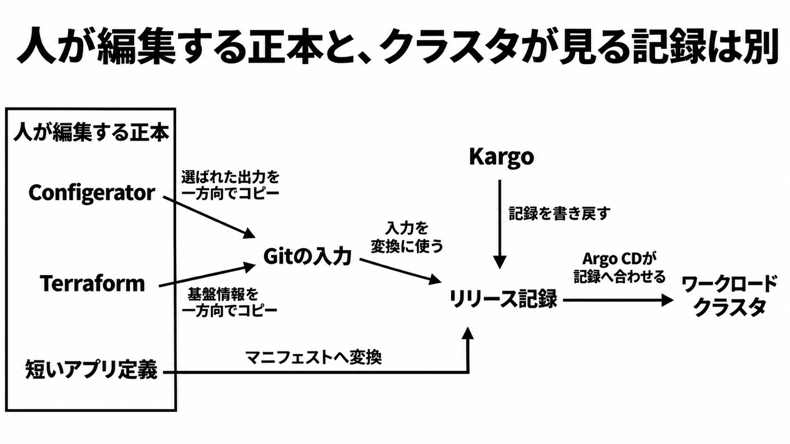

# ダイジェスト: 人が編集する正本と、クラスタが見る記録は別

[元記事](../../../../../articles/meta-ai-100-terraform-gitops-p8_20261112.md)

## ひとことで言うと

Meta は基盤を Terraform に残し、アプリ配備を Git の記録へクラスタを合わせる経路に分けました。

## 核心ポイント

- 以前は、アプリ配備も共有の Terraform workspace に乗っていました。止まった 1 本のアプリ配備が、他の数十本を遅らせ得ました。
- いまは、昇格（次の環境へ進める操作）を担う Kargo がリリースの記録を Git に書きます。Argo CD がクラスタをその記録に合わせます。
- アプリチームは、配備先や検証チェックを短いアプリ定義に書きます。プラットフォームがそれをマニフェストへ変換します。
- DaemonSet の Healthy が見るのは Pod の可用性までです。GPU が使えるかは見ません。

## メンタルモデル

左の枠の 3 つが、人が直接編集する正本です。クラスタが見る記録は、右側のリリース記録です。

## 具体例

クラウド資源が変わらない Helm の設定値 1 行も、Terraform の plan と昇格を通っていました。定常更新は 4 時間超でしたが、いまは数分で届きます。

## 適用と判断

向く場面:

- アプリの更新頻度が基盤と違います。
- 加えて、共有 workspace が無関係なリリースを待たせています。

確認すること:

- 直近の Helm 変更が何を待ったか、1 件調べましたか。
- 昇格の通過条件を、見たい事実を測る検証チェックにしましたか。
- 承認者、Terraform を変える人、アプリ定義を変える人を分けましたか。
- 望ましいリリースの記録を Git に残しましたか。
- 基盤と同時に出さないと動かない変更は、同じ昇格に残しましたか。

## 限界・注意点

- 4 時間超と数分は、測定条件のない自己申告です。
- 復旧、リリースの分離、ドリフト修復は、Meta がこれから検証する対象です。
- 昇格の手動承認は、検証と、次へ進む前の待ち時間を飛ばせます。承認者が経路の例外口になります。
- Pod を自動では置き換えない更新方式の DaemonSet は、更新完了前に Healthy を返し得ます。
- Meta の設定コンパイラと、図の一方向コピーは非公開です。ツールだけを入れても同じ結果にはなりません。

## 参考

- 元記事: [meta-ai-100-terraform-gitops-p8_20261112.md](../../../../../articles/meta-ai-100-terraform-gitops-p8_20261112.md)
- [CNCF 事例（Published: November 11, 2026）](https://www.cncf.io/case-studies/meta/)
- [Kargo の検証](https://docs.kargo.io/user-guide/how-to-guides/verification)
- [Argo CD の Resource Health](https://argo-cd.readthedocs.io/en/stable/operator-manual/health/)
- [DaemonSet の health 実装（master、2026-11-12 取得）](https://raw.githubusercontent.com/argoproj/argo-cd/master/gitops-engine/pkg/health/health_daemonset.go)
