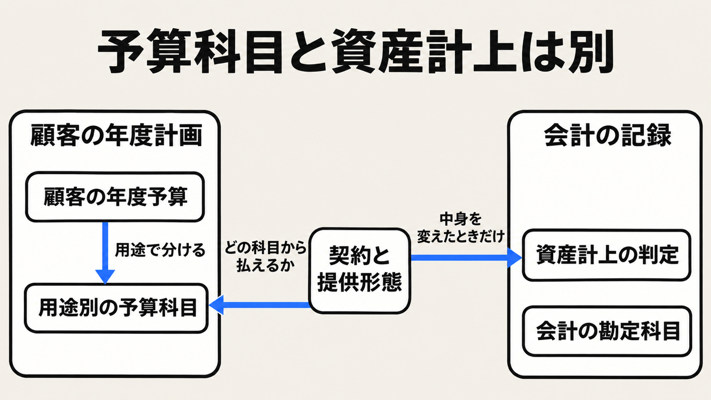

# ダイジェスト: PYF は予算の用途を見る

[元記事](../../../../../articles/pyf-product-yosan-kamoku-fit_20261112.md)

## ひとことで言うと

PYF（プロダクト予算科目フィット）は、才流が示した、費用が顧客のどの予算科目から払われるかを見る視点です。

## 核心ポイント

- 予算科目は、年度予算で支出を計画するときの用途別の項目です。会計の勘定科目とは別です。
- すでにある予算から払ってもらうと、新しく予算を取るより稟議の説明がしやすくなります。
- 既存の枠組みは、払う意思があるか、予算が承認されるかまでを見ます。PYF は、どの予算科目から払うかまで見ます。
- 予算科目を「設備投資」に変えるだけでは、会計上の資産にはなりません。資産になるかは、顧客がソフトウェアを取得する契約かなど、契約の中身と会計基準で決まります。

## メンタルモデル

中央の「契約と提供形態」から、左右へ矢印をたどって読みます。左は払える予算科目、右は資産計上の判定です。

## 具体例

製造業向け SaaS の事例は、予算科目をソフトウェア利用料から設備投資へ変えました。提案先も、情報システム部門から生産技術部門や工場長へ変えました。契約の中身は公開されていません。

## 適用と判断

向く場面:

- 予算を動かしにくい顧客で、大きな既存科目に契約と提供形態を合わせられるときです。

確認すること:

- 今期の用途別予算と、払える契約の中身を一緒に聞きましたか。
- 月額利用を、会計上の資産にできると約束していませんか。
- 決裁者が支出を動かせるとき、単価を小さい予算科目の規模に縛っていませんか。
- 顧客は、その用途にすでに支払っていますか。
- 失注の原因を、予算科目以外でも切り分けましたか。

## 限界・注意点

- 才流が2026年11月10日に提示した新しい考え方です。
- 効果を示す受注率や期間の数値はありません。
- 事例の一部は匿名で、外部から検証できません。
- すでにある予算の方が稟議を通りやすいことを示す公開データは見つかっていません。

## 参考

- 元記事: [pyf-product-yosan-kamoku-fit_20261112.md](../../../../../articles/pyf-product-yosan-kamoku-fit_20261112.md)
- [栗原康太「PYF（Product Yosan-kamoku Fit：プロダクト予算科目フィット）という考え方」株式会社才流](https://sairu.co.jp/method/110306/)
- [企業会計基準委員会 移管指針第8号](https://www.asb-j.jp/jp/wp-content/uploads/sites/4/kichu_20251016_35.pdf)
- [企業会計基準委員会 企業会計基準適用指針第33号](https://www.asb-j.jp/jp/wp-content/uploads/sites/4/ecl20261016_23.pdf)
- [国税庁 No.5461 ソフトウェアの取得価額と耐用年数](https://www.nta.go.jp/taxes/shiraberu/taxanswer/hojin/5461.htm)
