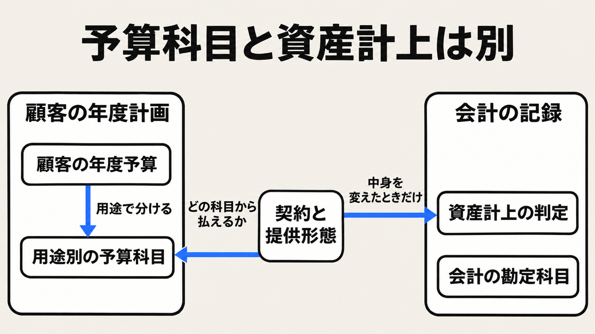

# ダイジェスト: PYF は予算の用途を見る

[元記事](../../../../../articles/pyf-product-yosan-kamoku-fit_20261112.md)

## ひとことで言うと

PYF（プロダクト予算科目フィット）は、顧客の年度予算のどの用途から払うかを見る視点です。その用途の名前を提案書で変えても、資産にはなりません。

## 核心ポイント

- 予算科目は、会計の勘定科目（財務会計で取引を分類する項目）ではありません。年度予算で支出を計画するときの用途別の項目で、研修費、業務委託費、広告宣伝費、システム投資費が例です。
- PYF が見るのは、課題があるかや解決策が良いかではなく、支払いがどの用途別予算から出るかです。才流（BtoBマーケティング支援の株式会社）の記事は、新規に予算を取るより既存予算の再配分の方が稟議の説明がしやすい、と書きます。
- PSF（課題と解決策のフィット）が予算について見るのは、対価を払う意思までで、費目の名前は見ません。BANT（予算、決裁権、必要性、導入時期で商談の見込みを判定する枠）が見るのは、予算がどう特定され、いつ承認されるかまでで、費目の名前は聞きません。
- 資産になる経路があるのは、顧客がソフトウェアを取得する契約（移管指針第8号では、将来の収益獲得または費用削減が確実なときだけ無形固定資産）、機械と一体でなければ機能しないソフトウェアを機械の取得原価に含める契約、特定の機器などの使用を顧客が支配するリース契約（企業会計基準適用指針第33号）です。月額の利用料を資産にする、という記述は移管指針第8号の第11項にはありません。
- PYF は、2026年11月12日時点の才流の用語集にもフィットジャーニー（新規事業の進み方を段階で呼ぶ整理）にも入っておらず、どの段階に入れるかは指定がありません。効きやすいのは、年度予算が硬く大きな既存費目に契約の実態を合わせられるときで、これは元記事の筆者の判断です。

## メンタルモデル

自社が変えられるのは、契約と提供形態をどの科目に載せるかです。会計の勘定科目と、資産になるかの判定は、そのラベルとは別です。

## 具体例

製造業向け SaaS は、ソフトウェア利用料から設備投資へ、提案先を情報システム部門から生産技術部門や工場長へ変えた、と才流の記事にあります。資産計上できるかは契約形態と会計基準によると、才流自身が留保しています。契約の中身は公開されていないため、どの経路だったかは分かりません。

## 適用と判断

向く場面:

- 「評価は高いのに受注しない」とき、原因を予算科目のずれとして切り分ける。
- 提供形態を変えると、別の科目から支払えるかを確認する。

確認すること:

- 今期の用途別予算と、そこから支払える契約の中身をセットで聞き、費目名だけは変えない。
- ソフトウェアの月額利用は、設備投資として資産計上できると約束しない。
- 顧客が使うソフトウェアのトレーニング費用は、移管指針第8号ではその期の費用です。
- 決裁者が支出を動かせるとき、まだ支払っていない相手、予算以外の失注の切り分けは、元記事のチェックリストにあります。
- 略称の PYF は、給料から先に貯蓄へ回す Pay Yourself First とも重なるので、初出ではプロダクト予算科目フィットと展開します。

## 限界・注意点

- 才流の記事が書く効果は定性的です。受注率、期間、金額、市場規模の数値は示されていません。
- 製造業向け SaaS と、業務改善ではなく AI 活用プロジェクトとして提案した事例は匿名で、社名、時期、件数、予算額は外部から検証できません。AI の事例は、予算科目だけでなく経営の投資優先度も効いている、と才流の記事の著者は限定しています。
- 研究会を教育研修費で払えるよう研修動画を加えた、という記述は、2026年11月12日の公開ページでは確認できません。ページに無いことから動画追加自体は否定できず、才流の記事の著者は研修動画の付加価値も効いていると認めています。
- 再配分の方が新規予算より稟議を通りやすい、という通過率の公開データは、その逆を示すものも含めて見つかりませんでした。
- 会計は不明なら費用とし、税務（国税庁 No.5461）は将来の収益獲得や費用削減にならないことが明らかな場合だけ取得価額から外します。条件が違うので、提案側が「資産になります」と一律には言えません。

## 参考

- 元記事: [pyf-product-yosan-kamoku-fit_20261112.md](../../../../../articles/pyf-product-yosan-kamoku-fit_20261112.md)
- [栗原康太「PYF（Product Yosan-kamoku Fit：プロダクト予算科目フィット）という考え方」株式会社才流](https://sairu.co.jp/method/110306/)
- [企業会計基準委員会 移管指針第8号](https://www.asb-j.jp/jp/wp-content/uploads/sites/4/kichu_20251016_35.pdf)
- [企業会計基準委員会 企業会計基準適用指針第33号](https://www.asb-j.jp/jp/wp-content/uploads/sites/4/ecl20261016_23.pdf)
- [国税庁 No.5461 ソフトウェアの取得価額と耐用年数](https://www.nta.go.jp/taxes/shiraberu/taxanswer/hojin/5461.htm)
