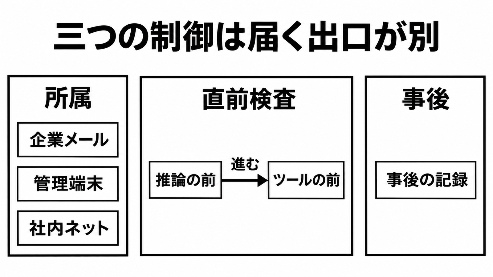

# ダイジェスト: 所属と直前検査と事後記録は別

[元記事](../../../../../articles/anthropic-claude-enterprise-p7_20261113.md)

## ひとことで言うと

Anthropicは2026年11月5日、アカウントの所属と直前検査と事後記録を分けました。

## 核心ポイント

- 制御は、アカウントの所属、送る直前の検査、事後の記録に分かれます。
- 社内ネットは、管理された通信の入口だけで止めます。
- 組織か委託先のサーバが、許可か拒否を返すまで待ちます。
- サインアウトは、APIキーと実行中のクラウドセッションと、予定した繰り返しを残します。
- Claude Codeの管理設定でログイン固定を置くと、APIキーと認証トークンと、鍵を返す補助は起動時に止まります。

## メンタルモデル

題の出口は、各枠が届く先です。
矢印は中央だけで、推論の前からツールの前へ進みます。

## 具体例

企業ドメインでない個人メールは、この請求の対象外です。カスタムスキルと、外部サービスへの接続は移りません。HIPAA対応か、顧客管理の暗号鍵の組織へ請求で移す人は、新しく始めます。

## 適用と判断

向く場面:

- コーディングエージェントの権限を揃える前です。
- 個人アカウントを業務から切るか決めるときです。
- 送信の直前に許可か拒否で止めるときです。

確認すること:

- 検証済みドメインの個人アカウントを、請求開始から30日で移しますか。
- 管理端末では、サインインの前から組織を固定しますか。
- 自分のAPIキーを、セッションの開始時に止めますか。
- 検査が失敗したとき、リクエストを止めますか。
- この検査で、画像とファイルの生データまで見ていますか。

## 限界・注意点

- 検査が失敗したときの初めの設定は、リクエストを通します。
- 設定した割合から外れた依頼は、止める設定でも検査を飛ばします。
- デスクトップの切替は、最初のサインイン前も、30日使わないあとも覆いません。
- 直前検査は、API専用の組織と、BedrockとGoogle Cloudでは使えません。
- 事後のログと、端末の中の検知は、操作を止めません。

## 参考

- 元記事: [anthropic-claude-enterprise-p7_20261113.md](../../../../../articles/anthropic-claude-enterprise-p7_20261113.md)
- [More visibility and control over Claude Enterprise for security teams（2026-11-05）](https://claude.com/resources/articles/claude-enterprise-security-updates)
- [Inference hooks 概要](https://platform.claude.com/docs/en/manage-claude/inference-hooks)
- [テナント制限](https://support.claude.com/en/articles/13198485-enforce-network-level-access-control-with-tenant-restrictions)
- [Claude Code admin setup](https://code.claude.com/docs/en/admin-setup)
