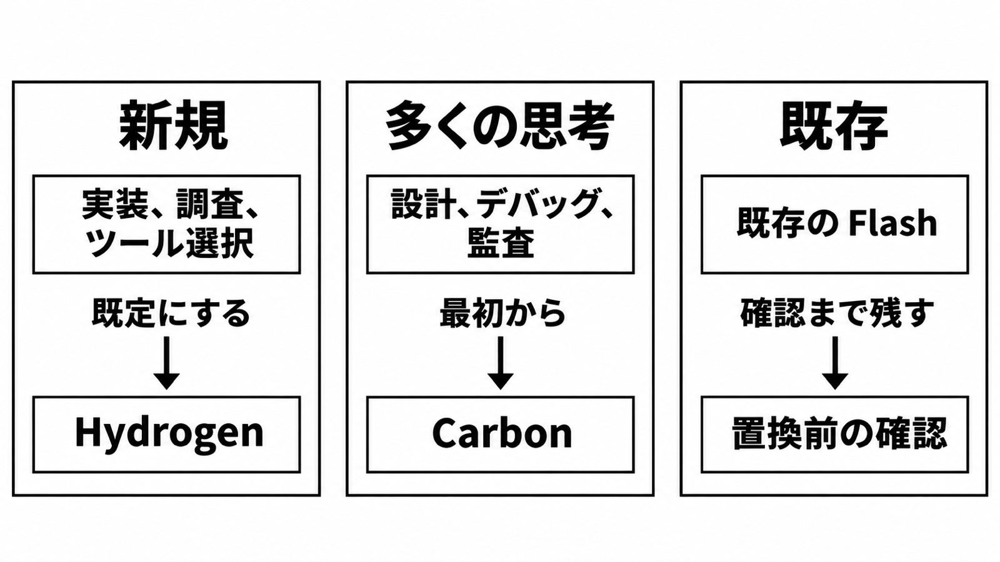

# ダイジェスト: Gemini 4 Hydrogen を実装の既定にする条件

[元記事](../../../../../articles/google-gemini-hydrogen-google-p1_20261113.md)

## ひとことで言うと

新規の実装、調査、ツール選択は Gemini 4 Hydrogen を既定にし、考える量は呼び出しごとに指定します。

## 核心ポイント

- 呼び出す ID は `gemini-4-hydrogen` です。
- 入力、思考トークン、出力は 1,048,576 トークンを共有します。
- 設計、難しいデバッグ、セキュリティ監査は Carbon（より多く考えるモデル）から始めます。セキュリティ監査は調査でも Hydrogen に残しません。
- 既存の 3.8 Flash Standard（更新元のモデル）は、2026-12-31 までは確認まで一括で替えません。
- Google 検索への搭載は、開発者向け API でモデルを選ぶこととは別です。

## メンタルモデル

中央の枠は、設計、難しいデバッグ、セキュリティ監査です。矢印の先が置き場です。

## 具体例

考える量の既定は high です。仕事では次のように明示します。

| 仕事 | 考える量 |
|---|---|
| 速さのツール往復 | medium |
| 品質の本処理 | high |
| high で足りない複数段 | xhigh |

複数段とは別に、品質不足なら xhigh か Carbon です。選択の追加条件はありません。

## 適用と判断

向く場面:

- 新規の実装、調査、ツール選択の既定を決めます。
- 既存の更新元モデルを残す期間を判断します。
- 音声生成、画像生成、音声対話が要る仕事を外します。

確認すること:

- 失敗したツールからの回復を見ましたか。
- 既定が medium から high に変わる費用を測りましたか。
- 既定が medium から high に変わる挙動を測りましたか。
- 明示キャッシュを外した入力費用を見ましたか。
- 温度指定が無視されるかを見ましたか。

## 限界・注意点

- 既定の high では、タスク完了が 2.5 倍速いです。比較相手は特定できません。
- 2026 年末まで、同じトークン数の標準料金は更新元の約 2 倍です。思考の既定が high になると、費用差はさらに開き得ます。
- 並列の関数呼び出しでは、応答の署名のコピーと、履歴の先頭の削除がエラーになり得ます。
- 不当な拒否は、更新元より増えます。人手の再確認では、悪化の多くは偽陽性か、深刻ではありません。
- 退役日と API の停止日は、公開資料にありません。

## 参考

- 元記事: [コーディングエージェントでGemini 4 Hydrogenを実装帯の既定にする条件](../../../../../articles/google-gemini-hydrogen-google-p1_20261113.md)
- [What's new in Gemini 4 Hydrogen](https://aistudio.google.com/docs/whats-new-gemini-4-hydrogen)
- [Gemini 4 Hydrogen model](https://aistudio.google.com/docs/models/gemini-4-hydrogen)
- [Gemini Developer API pricing](https://aistudio.google.com/docs/pricing)
- [Introducing Gemini 4 Hydrogen](https://blog.google/innovation-and-ai/models-and-research/gemini-models/introducing-gemini-4-hydrogen/)
