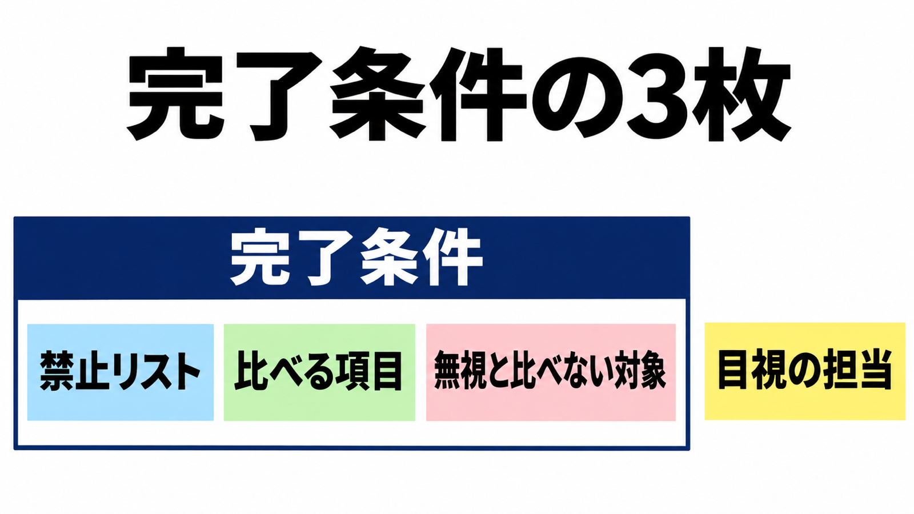

# ダイジェスト: PHP基幹をJavaへ移す完了条件

[元記事](../../../../../articles/php-865-java-zenn-dev-soliperse-p6_20261113.md)

## ひとことで言うと

発注側が叶小钗氏の手順から書く完了条件は、禁止リスト、比べる項目、無視と比べない対象の3枚です。

## 核心ポイント

- 作業の単位は URL です。前編の確認項目は、渡す値、分岐、戻り値、データベース、副作用、異常時です。
- 同じリクエストの応答を、PHP と Java で比べます。手順は、差があるときだけキャッシュを外し、外しても残る差を業務の処理の差とします。
- 無視する例は、処理時間、リクエストごとの ID、文字列と数値の差です。
- 見た誤りは、禁止リストへ1件ずつ足します。
- 注文の約 −0.8% は、Java 7,418 件と PHP 7,475 件の再計算と合う自己申告です。

## メンタルモデル

左の枠が完了条件です。右の箱は、枠に入らない挙動の担当です。

## 具体例

公開例の項目は、商品ID、題名、価格、元の価格などです。末尾は省略で、例に無い項目を見ていなかったとは言えません。

## 適用と判断

向く場面:

- 移行の完了を、応答比較の仕様で書くときです。
- 見た誤りを禁止リストへ足してから実装させるときです。

確認すること:

- 比べる項目の全リストを別に書きましたか。
- 落とす不一致を完了条件へ列挙しましたか。
- 応答に出ない在庫や決済を比べない対象に書きましたか。
- リストに無い挙動が差分の外で通る穴を書きましたか。
- 3枚に無い挙動の目視担当を決めましたか。

## 限界・注意点

- 865行の禁止リストのファイルは、2026年11月13日の検索では見つかっていません。
- キャッシュを外す条件の文と、外したとき増える差の分類が並び、どちらを実装したかは未確認です。
- データベースと副作用は、応答に無ければ比較の外です。在庫、決済、応答のあと処理も同じです。
- 注文件数が、値を隠したあとの数かは分かりません。
- 営収 −0.6% は、式と数えた期間が非公開なので、台帳が公開されるまで採用しません。

## 参考

- 元記事: [php-865-java-zenn-dev-soliperse-p6_20261113.md](../../../../../articles/php-865-java-zenn-dev-soliperse-p6_20261113.md)
- [叶小钗、前編「AI Coding 实战：10年祖传系统，54万行代码，2周重构结束」。博客园、2026年3月25日](https://www.cnblogs.com/yexiaochai/p/19772177)
- [続編の転載「AI Coding 实战：2周重构54万行代码，真的吗？」。AtomGit / CSDN、表示2026年3月30日](https://gitcode.csdn.net/69ca720554b52172bc658bd0.html)
