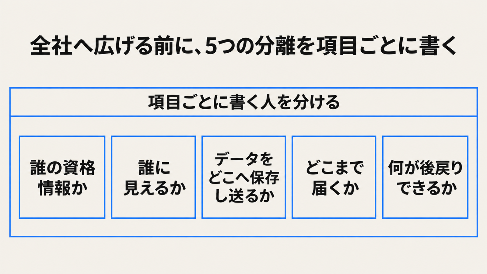

# ダイジェスト: 全社展開で写す5つの分離

[元記事](../../../../../articles/ubie-zenn-dev-ubie-45501469-p5_20261113.md)

## ひとことで言うと

Ubieの社内エージェントを全社へ広げるとき、写すのは5つの分離です。

## 核心ポイント

- 依頼者本人の認可は、その人のセッションだけで、複数人が結果を見る場からは使えません。その場は、閲覧範囲用の資格情報で動きます。
- 資格情報はサンドボックスの中に置かず、許可した宛先への通信にだけ載せます。
- 承認を外せるのは、資格情報が許可先以外へ届かず、その役割が戻せると判断したときだけです。
- 閲覧範囲の資格情報は、モデルが読む規範とは別に、ツール呼び出しのたびにかかります。
- 法務では、エージェントの最初の回答と、担当者があとで下した判断の差で、モデルへ渡す指示を更新します。

## メンタルモデル

左から順に読みます。項目ごとに書く人を分けます。

## 具体例

複数人が結果を見る場で、依頼者の権限のまま読むと、経営会議の情報がパートナーに見えます。

## 適用と判断

向く場面:

- 開発以外の職務へ、社内エージェントを広げる前の設計に向きます。

確認すること:

- 起動経路ごとに、誰の資格情報かを書いたか。
- その場に誰がいるかで、見える範囲を分けたか。
- 保存先と送信先モデルを、法令と会社の選択に分けたか。
- 許可済みの操作で起きうることを、承認を外す条件に含めたか。
- 戻せるかの判断を、基盤を作るチームの外に置いたか。

## 限界・注意点

- 複数人が結果を見る場に紐づかない起動の、資格情報の持ち主は、公開記事にありません。
- 後戻りできない変更の一覧は、公開範囲では空欄です。
- 改善の提案を誰が取り込むかは、公開記事にありません。
- 別の社内基盤の利用率や問い合わせ時間は、このエージェントの成績ではありません。
- 医療情報のガイドラインの確認文は、処理場所を日本に固定する義務とは違います。

## 参考

- 元記事: [ubie-zenn-dev-ubie-45501469-p5_20261113.md](../../../../../articles/ubie-zenn-dev-ubie-45501469-p5_20261113.md)
- [Ubie、Software Factoryの先へ](https://zenn.dev/ubie_dev/articles/45501469c9c044)
- [厚生労働省、医療情報システムの安全管理に関するガイドライン第7.0版の案内](https://www.mhlw.go.jp/stf/shingi/0000516275_00006.html)
