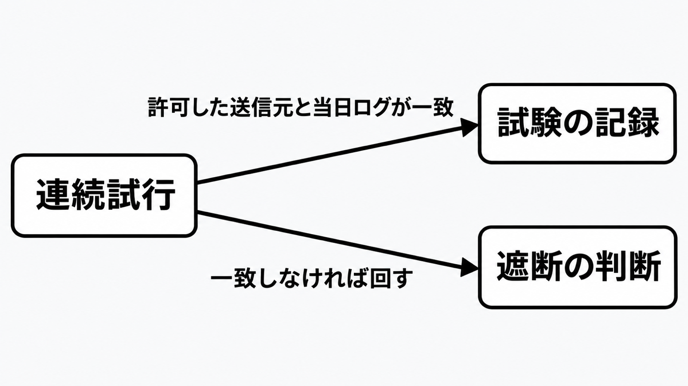

# ダイジェスト: 連続試行は許可した送信元で分ける

[元記事](../../../../../articles/ai-cloudflare-adapting-to-p6_20261114.md)

## ひとことで言うと

届く連続試行は許可した試験の送信元で分け、公開アプリ以外の入口は先に消します。

## 核心ポイント

- 止める候補は、同じ発信元が短い時間に、パスや結果を変えながら続く試行です。
- 公開アプリ以外の管理画面、診断用の入口、遠隔操作の入口は、止めるルールより先に消します。
- 受け付けるデータの形で通信を止めるには、止めるルールを別に書きます。
- 許可した試験の送信元と当日のログが一致しないものは、その試験として通しません。
- 当番がその場で遮断と解除を出せないなら、その連続試行はアラートです。

## メンタルモデル

上の矢印は、一致した試行の記録へ向かいます。
下の矢印は、一致しない試行の判断へ向かいます。

## 具体例

ある事後調査では、期限の無いAPIトークンが使われていました。観測は分あたり69を超えるリクエストと、時間あたり400件の、データベースの中身をまとめて取り出す要求です。

## 適用と判断

向く場面:

- 公開を続けるアプリの検知を見直すときです。
- 期限もIPアドレスの制限も無いトークンを探すときです。
- 公式の件数制限だけで連続試行を止めようとするときです。

確認すること:

- 同じ発信元が短時間にパスや結果を変える列を、1件と別に数えていますか。
- 管理画面は、止めるルールより前にインターネットから消していますか。

## 限界・注意点

- 公式の件数制限が止めるのは、件数で表せる部分だけです。
- 具体例の件数は、自社のしきい値には写しません。
- 公式の件数制限は、データセンタごとに集計し、更新に数秒遅れます。
- 期限もIPアドレスの制限も無いトークンは、インターネットから使えるままには置きません。
- 無効にするか、IPアドレスの制限を足すかは、一つの手順にはなっていません。

## 参考

- 元記事: [ai-cloudflare-adapting-to-p6_20261114.md](../../../../../articles/ai-cloudflare-adapting-to-p6_20261114.md)
- [Cloudflare, Adapting to AI penetration testing orchestrators（2026年11月13日）](https://blog.cloudflare.com/adapting-to-ai-penetration-testing-orchestrators/)
- [Cloudflare Docs, Rate limiting rules（最終更新 2026年8月25日）](https://developers.cloudflare.com/waf/rate-limiting-rules/)
- [Cloudflare Docs, Schema validation（最終更新 2026年11月11日）](https://developers.cloudflare.com/api-shield/security/schema-validation/)
- [NIST, SP 800-61 Rev. 3（2025年4月3日）](https://csrc.nist.gov/pubs/sp/800/61/r3/final)
