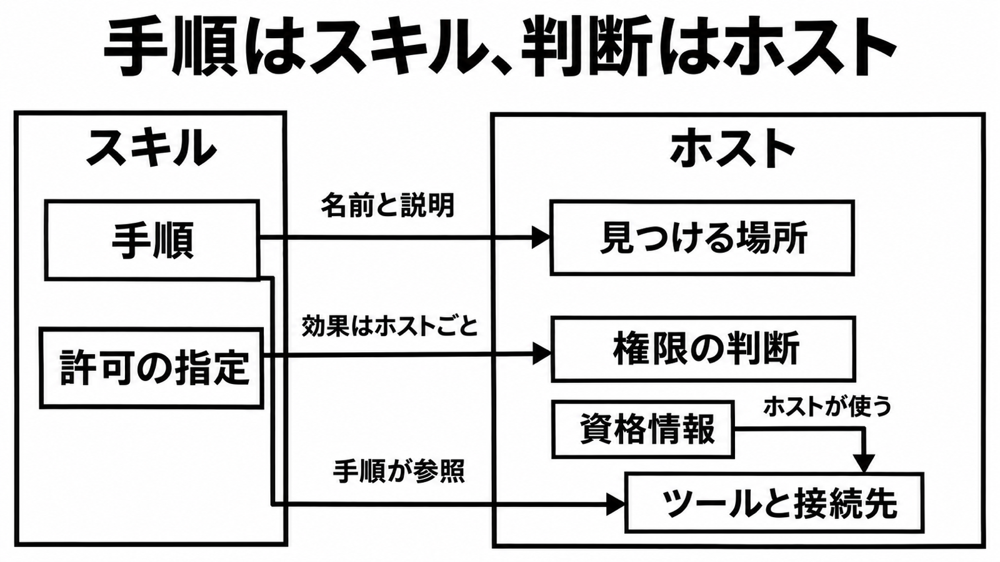

# ダイジェスト: 手順は共有し、判断はホストに残す

[元記事](../../../../../articles/github-ai-ml-copilot-build-p3_20261114.md)

## ひとことで言うと

Agent Skillsは手順のファイルを共有します。ツールと権限は実行する製品が持ちます。

## 核心ポイント

- 共有できるのは、SKILL.md を中心にした手順のファイルです。
- ツール、資格情報、接続先、権限の最終判断はホスト（実行する製品）が持ちます。
- 許可の指定（allowed-tools）の効果は、ホストごとに違います。
- 見本の生成は、metadata.agent-tools が無いと read と search を入れます。入れる先は、Copilot向けの tools です。
- Copilotのコードレビューは、プルリクエストの変更ブランチのスキルを読みます。

## メンタルモデル

左がスキル、右がホストです。
見つける場所はホストが探すパスで、そこへの矢印は起動時の名前と説明です。

## 具体例

| ホスト | 確認の扱い |
| --- | --- |
| Copilot | 許可の指定に書いたツールは、確認なしで使えます。 |
| Claude Code | その確認なしは、次のメッセージで消えます。 |
| Copilot SDK | 権限は付与せず、要求ごとに許可を決める処理が判断します。 |

## 適用と判断

向く場面:

- 同じ手順を複数のホストへ配る前です。
- Copilot以外のCLIでも動くとカタログへ書く前です。

確認すること:

- 別ホストで同じ手順が落ちたとき、見つからないことが原因ですか。
- 別ホストで同じ手順が落ちたとき、許可の扱いが原因ですか。
- 別ホストで同じ手順が落ちたとき、生成した tools と元の差が原因ですか。
- 資格情報をスキルのファイルへ書いていませんか。
- 導入前にスキルの中身を見ましたか。

## 限界・注意点

- Claude Codeは、管理ルールだけの設定で、プロジェクトスキルと個人スキルの許可指定を無視します。対象は v2.1.282 以降です。
- Claude Codeは未検証のGitフォルダで、gitを含むBashとパースできないBashの許可だけを無視します。
- Claude Codeは、載っていないツールを禁止しません。
- 手順に同梱した実行ファイルは、コマンドの許可の指定と重なると、確認なしで動きます。
- CodexとGemini CLIの許可指定の扱いは、一次資料にありません。

## 参考

- 元記事: [github-ai-ml-copilot-build-p3_20261114.md](../../../../../articles/github-ai-ml-copilot-build-p3_20261114.md)
- [Build once, run on any agent（GitHub Blog、2026-11-12）](https://github.blog/ai-and-ml/github-copilot/build-once-run-on-any-agent-a-practical-guide-to-agent-skills/)
- [Agent Skills specification](https://agentskills.io/specification)
- [Adding agent skills for GitHub Copilot](https://docs.github.com/en/copilot/how-tos/copilot-on-github/customize-copilot/customize-cloud-agent/add-skills)
- [Custom skills（Copilot SDK）](https://docs.github.com/en/copilot/how-tos/copilot-sdk/use-copilot-sdk/custom-skills)
- [Extend Claude with skills](https://code.claude.com/docs/en/skills)
