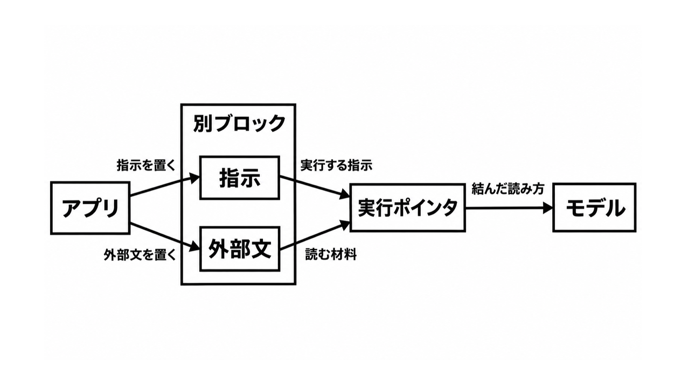

# ダイジェスト: 指示と外部文は別ブロック

[元記事](../../../../../articles/granite-4-1-llm-llmon-co-p4_20261114.md)

## ひとことで言うと

IBMのGranite 4.1 LLMONでは、アプリが指示と外部文を別ブロックで渡します。

## 核心ポイント

- LLMON（指示と外部文の印）は、実行する指示と読む材料を別々に指します。
- チャットの入力欄に書いた文は、実行する指示1件になります。
- タスクの本文に混ぜた命令が通る割合は、通常のチャットよりおおよそ3桁下がります。
- 道具が返した文に混ぜた命令は、3Bという名前で5.6%、8Bという名前で3.1%残ります。
- 利用者自身が書く命令は、外部文と分ける対象になりません。

## メンタルモデル

左がアプリ、中央の枠が別ブロックです。
「結んだ読み方」は、実行ポインタからモデルへの矢印です。

## 具体例

題名を提案する指示と、返金を求めるメール本文は、別の枠です。これは説明用の例で、チャットの入力欄の実物ではありません。

## 適用と判断

向く場面:

- メールや検索結果を、この実験公開へ渡すときです。
- 出力した要約を、次の入力へ戻す前です。
- 外部文にすでに入っている命令を、この分け方で防ぐときです。

確認すること:

- 外部文は、読む材料の側に置いていますか。
- 戻す要約やログは、次の入力で指示の側に入っていませんか。
- 防ぐ相手は、外部文にすでに入っている命令ですか。
- 道具の実行権限は、別に狭めていますか。
- 送る前の検査は、別に残していますか。

## 限界・注意点

- 会話を重ねる攻撃は、この分け方の対象外です。
- メール本文などは、中身を検査せず、読む材料の枠へ足されます。
- このモデルは、探索と評価のための実験公開です。
- 分けた読み方を、モデルが必ず守る保証はありません。
- 日本語で外部文に混ぜた命令の成功率は、この論文の範囲外です。

## 参考

- 元記事: [granite-4-1-llm-llmon-co-p4_20261114.md](../../../../../articles/granite-4-1-llm-llmon-co-p4_20261114.md)
- [IBM Granite ブログ（2026-11-12）](https://huggingface.co/blog/ibm-granite/llmon-an-llm-native-markup-language-now-in-granite)
- [Shbita ほか、Post-Training Large Language Models with LLMON、arXiv:2610.38120v1](https://arxiv.org/abs/2610.38120)
- [granite-4.1-3b-llmon-preview](https://huggingface.co/ibm-granite/granite-4.1-3b-llmon-preview)
- [ツールキット generative-computing/llmon](https://github.com/generative-computing/llmon)
