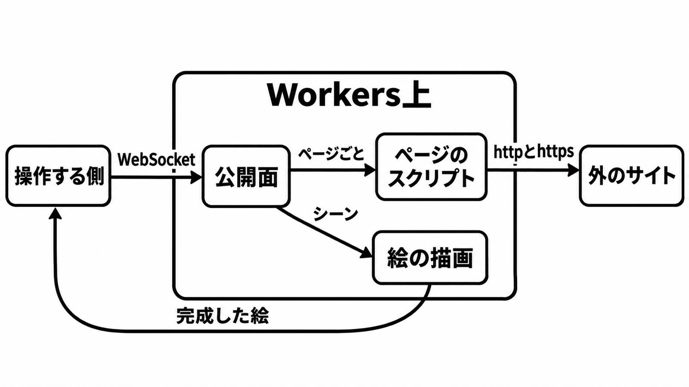

# ダイジェスト: Kitesurfの実行場所と再現範囲

[元記事](../../../../../articles/kitesurf-cloudflare-kitesurf-p5_20261114.md)

## ひとことで言うと

CloudflareのKitesurfは、ページのスクリプトと絵を分ける実験ブラウザです。

## 核心ポイント

- 操作する側からの接続で、ページのスクリプトと絵を頼みます。Workers（手元もクラウドも同じ）上で、その二つを分けます。
- Kitesurfは、手元、自分のWorkers、Cloudflareが管理する場所で動かします。
- クッキーは接続のあいだだけ残ります。接続をまたぐ保存は対象外です。
- 公開できるURLに置いたこのブラウザには、認証も回数制限もありません。
- Cloudflareは、自社で動かすKitesurfへのリクエストをbotと識別します。

## メンタルモデル

左が操作する側です。枠の中がWorkers上で、完成した絵は枠から左へ戻ります。

## 具体例

TodoMVCとWikipediaは、動くか試す例として挙がります。

## 適用と判断

向く場面:

- 短い公開ページで、絵が違っても判断が変わらないときです。
- Cloudflareが管理する場所で、botで止まらないページを読むときです。
- Workersの有料契約で、自分のWorkersへ載せるときです。

確認すること:

- 欲しいのが画面の絵か、ページ内の実行かを分けましたか。
- Cloudflareが管理するChromiumへ、ログインの継続を分けましたか。
- 公開URLの前に認証を置きましたか。
- 手元のこのブラウザを、自分のChromeのプロファイルと分けていますか。
- 対象のページが動くと分かっていますか。

## 限界・注意点

- 動画とページ内の3Dは、Cloudflareが管理するChromiumです。相手が接続の最初に見る特徴で止まる作業も同じです。
- 漢字が簡体字になり、ハングルが欠ける、という報告は未解決です。
- 残した絵を、Chromeの画面や、相手が返したバイトの記録にはしません。
- 公開名が内部のアドレスに解決されても止めません。
- 38ページの計測では、動かした場所が手元か自分のアカウントかCloudflareの管理か分かっていません。

## 参考

- 元記事: [kitesurf-cloudflare-kitesurf-p5_20261114.md](../../../../../articles/kitesurf-cloudflare-kitesurf-p5_20261114.md)
- [オープンソース記事（2026-11-13）](https://blog.cloudflare.com/kitesurf-open-source/)
- [Kitesurfの製品ドキュメント](https://developers.cloudflare.com/browser-run/kitesurf/)
- [AGENTS.md（対象コミット）](https://github.com/cloudflare/kitesurf/blob/4a2903813a22b08d4f3cc64a4b35339d0293a5d1/AGENTS.md)
- [リクエストをbotと識別するFAQ](https://developers.cloudflare.com/browser-run/faq/)
