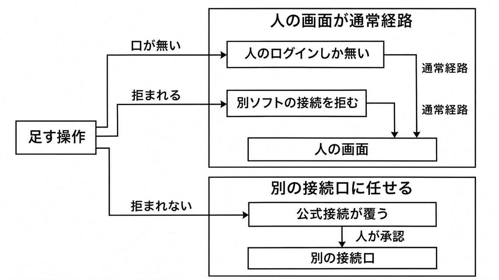

# ダイジェスト: 外部操作は公式接続で分ける

[元記事](../../../../../articles/ft-content-069-cdc48-e17a-p1_20261115.md)

## ひとことで言うと

外部サービスへ足す操作は、公式な接続が扱い、接続ソフトのIDを拒まないときだけ、人が承認する別の接続口にします。

## 核心ポイント

- 同じ事業者でも、操作ごとに分類が違います。
- 人のログインしか無い操作と、別ソフトとしての接続を拒む操作は、人の画面を通常経路に残します。
- 公式APIかOAuthスコープかPoppy発見ファイルがその操作を扱い、そのIDを拒まないときだけ別の接続口にします。
- 読み取りと、資金移動や支払先の変更は、別の許可にします。
- 共通仕様の設計に加わるだけでは、本番の接続は開いていません。

## メンタルモデル

「拒まれない」は、接続ソフトのIDが拒まれないことです。
「公式接続が覆う」は操作を扱うことであり、矢印と箱の両方が必要です。

## 具体例

JPMorgan Chase が外部エージェントのログインを拒むのは、人の画面側です。残る読み取り専用の接続では、資金移動と請求支払いは不可です。

## 適用と判断

向く場面:

- 依存する外部操作を足す前です。
- 既存の画面操作をエージェントへ渡すときです。
- 読み取りと資金移動を一つの許可にしようとしているときです。

確認すること:

- パスワード、クッキー、トークン、秘密鍵をモデルの入力に置いていませんか。
- 手元のツール許可と、相手が接続を受けることを分けていますか。

## 限界・注意点

- 2026年11月15日時点では、銀行が共通接続を本番で開いたことは確認できていません。
- 銀行のログイン拒否の整理は、法律事務所の二次情報です。
- 公式の接続や許可が足りない相手では、資格情報でのログインが残る想定です。
- 自社に依存するサービスの分類結果は、ここにはありません。

## 参考

- 元記事: [ft-content-069-cdc48-e17a-p1_20261115.md](../../../../../articles/ft-content-069-cdc48-e17a-p1_20261115.md)
- [Carlos Torres Vila 意見のスペイン語転載（Expansión、更新 2026-11-13）](https://www.expansion.com/economia/financial-times/2026/11/13/agentes-ia-deberian-necesitar-hacerse-pasar-nosotros.html)
- [Personal Agent Protocol specification 1.0](https://personalagentprotocol.org/docs/1.0/spec)
- [Sierra, Releasing Personal Agent Protocol 1.0（ページ表記 2026-11-13）](https://sierra.ai/blog/releasing-poppy)
- [Hunton Andrews Kurth（2026-11-03、二次情報）](https://www.hunton.com/insights/legal/major-banks-move-to-block-or-limit-customer-directed-ai-agents)
