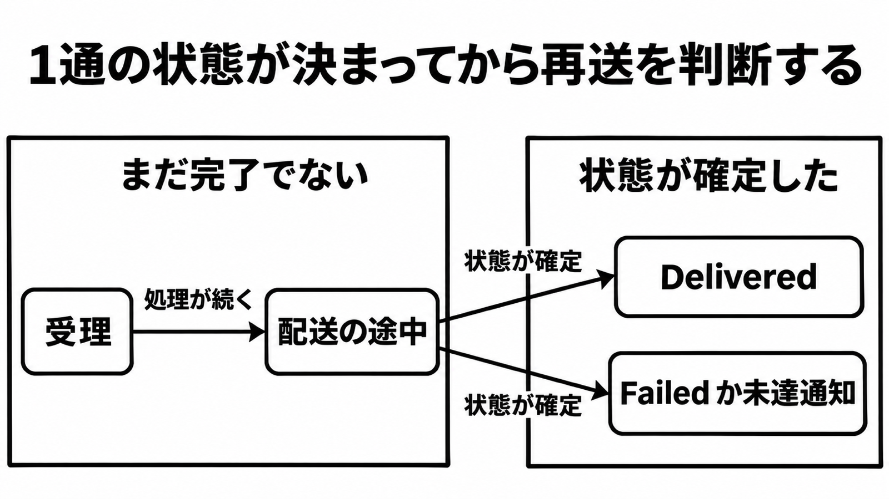

# ダイジェスト: 復旧後の再送は1通の状態で判断する

[元記事](../../../../../articles/microsoft-365-xtech-nikkei-p4_20261115.md)

## ひとことで言うと

Microsoft 365 の復旧後、再送は1通の配送状態で判断します。

## 核心ポイント

- サインインが先に戻っても、配送は追いつく途中になり得ます。
- 送信 API が返す 202 は、メールの受理です。
- 配送結果を見られないときは、送信者へ戻る知らせだけを届かなかった記録にします。
- Failed か未達通知（送信者へ戻る知らせ）のときだけ、同じ文面を送ります。
- 期限のあるコードや案内は、届くのを待たず、期限の前に新しいものとして送ります。

## メンタルモデル

左の枠は、受理と配送の途中です。
右の上は Delivered、下は Failed か未達通知です。

## 具体例

架空の例です。請求の PDF が Pending（試行中か再試行中）のままなら、同じ PDF をすぐ重ねません。

## 適用と判断

向く場面:

- 期限の無い業務メールを再送する前です。
- 送信 API の 202 を完了にしているときです。
- 配送結果を照会できない送信手順のときです。

確認すること:

- その通は、届いたか届かなかったかが決まっていますか。
- Pending のあいだ、コネクタ、MX、送信経路を変えていませんか。

## 限界・注意点

- 11月14日の復帰は、残る顧客へのサービス復帰です。溜まったメールの処理完了は、この復帰では未確認です。
- Delivered は、人が読んだことまでは示しません。
- 迷惑メールや検疫でも、状態は Delivered になり得ます。
- 届かなかった通数は、公開されていません。
- 事後報告書は、11月15日時点で未確認です。

## 参考

- 元記事: [microsoft-365-xtech-nikkei-p4_20261115.md](../../../../../articles/microsoft-365-xtech-nikkei-p4_20261115.md)
- [Microsoft 365 Status、サインインと配送の時間差（2026-11-13 20:05 UTC）](https://x.com/MSFT365Status/status/2121333700591857878)
- [Microsoft 365 Status、残る顧客への復帰（2026-11-14 06:09 UTC）](https://x.com/MSFT365Status/status/2121485746334777593)
- [1通の配送結果の見方](https://learn.microsoft.com/en-us/exchange/monitoring/trace-an-email-message/message-trace-modern-eac)
- [送信 API の受理](https://learn.microsoft.com/en-us/graph/api/user-sendmail?view=graph-rest-1.0)
