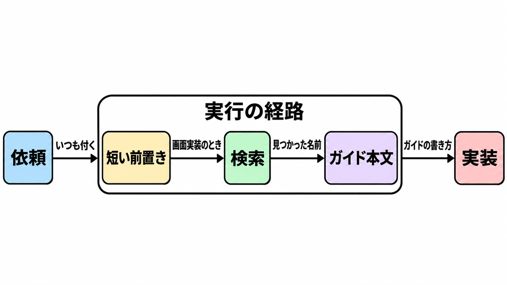

# ダイジェスト: 画面実装のときだけガイドを渡す

[元記事](../../../../../articles/modern-web-guidance_20261115.md)

## ひとことで言うと

ChromeのModern Web Guidanceは、画面実装のときだけ該当ガイドを渡します。

## 核心ポイント

- 画面のHTML、CSS、クライアント側JavaScriptのときだけ、該当ガイドを読みます。
- 既定は、主要ブラウザで広く使える機能です。まだ広く使えない機能は、非対応でも動く形で足すか、条件付きの短い代替にします。
- 試験公開（期間限定の実験）と、出荷から3か月以内か、まだ安定していない単一エンジンだけの機能は検索に出ます。本文は人が許可するまで返しません。
- 検索は英語の2語から5語程度の動作で、1つの機能に分けます。
- 検索文字列は既定で送られます。DISABLE_TELEMETRY の 1 か true で止まります。

## メンタルモデル

五つの箱は左から右へ進みます。検索の次の矢印は、見つかったガイドの名前です。

## 具体例

公開された評価では、同じ作業の採点合格率がガイドなしより27から36ポイント高いです。

## 適用と判断

確認すること:

- 検索した文字列の送信を止めるか、決めましたか。

## 限界・注意点

- ガイド本文の対応状況は、そのパッケージを作った時点の値です。取得のたびに最新を問い合わせません。
- CLIで入れた1.0.0の更新は、人が update を実行したときだけです。
- 対応範囲の引数に baseline と書くと、newly（新しい機能まで）として保存されます。既定へ戻すときは widely（広く使える）を渡します。

## 参考

- 元記事: [modern-web-guidance_20261115.md](../../../../../articles/modern-web-guidance_20261115.md)
- [Modern Web Guidance](https://developer.chrome.com/docs/modern-web-guidance)
- [Modern Web Guidance 1.0](https://developer.chrome.com/blog/modern-web-guidance-v1)
- [GoogleChrome/modern-web-guidance](https://github.com/GoogleChrome/modern-web-guidance)
- [GoogleChrome/modern-web-guidance-src](https://github.com/GoogleChrome/modern-web-guidance-src)
