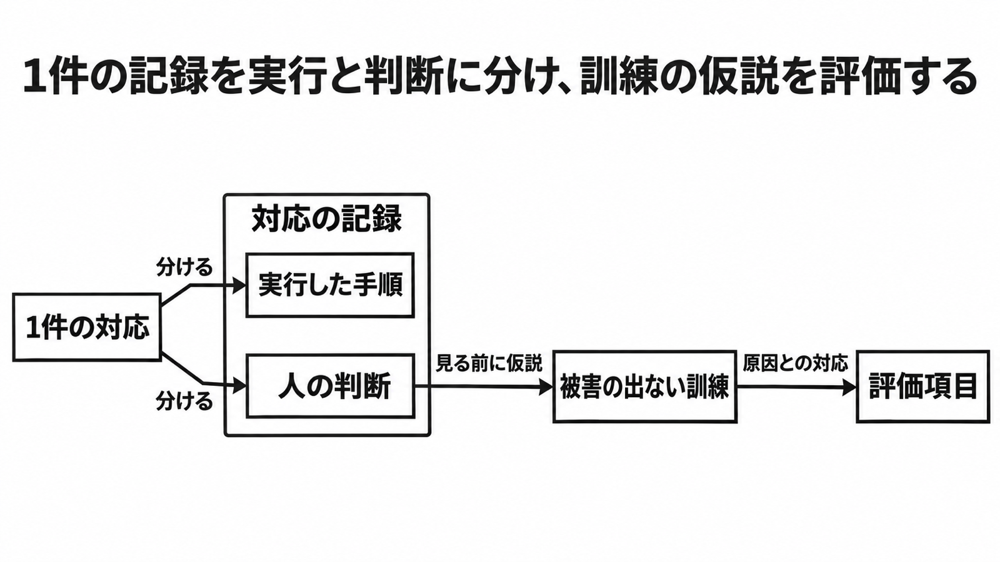

# ダイジェスト: 新規の障害の技能は被害の出ない訓練で残す

[元記事](../../../../../articles/gigazine-20261115-ai-isnt-p4_20261116.md)

## ひとことで言うと

障害対応の当番では、新規の障害の技能を被害の出ない訓練で残します。

## 核心ポイント

- 定型の障害対応は AI が実行し、人はその出力を受け取ります。新規の障害は人の仮説から始まります。
- 練習の中心は、被害を切り離した訓練だけに置きます。
- 本番の記録は、AI が実行した手順と、人が下した判断に分けます。

## メンタルモデル

左の枠の実行した手順は、AI が行った手順です。
判断から右へ、被害の出ない訓練を経て評価へ進みます。

## 具体例

利用者に影響しない環境で、障害を1回再現します。AI の出力を隠して仮説を書いてから、その出力を開きます。

## 適用と判断

向く場面:

- 定型の障害対応を自動化したあとです。
- 当番の評価項目を決めるときです。
- 本番の定型を、人の練習にするか迷うときです。

確認すること:

- 予定した訓練で、出力を見る前の仮説が原因とどこまで対応したかを残しますか。
- 採用するか却下するかの理由を、1行残していますか。
- 仮説と理由の欄は、当番を見守った回数とは別ですか。

## 限界・注意点

- 障害対応の担当で、AI を入れる前後の診断の技能を測った研究は、確認できていません。
- 記録の分割は、技能が落ちた証拠にも、戻った証拠にもなりません。
- 自チームか公開研究で、定型を人に戻した前後と切り離した訓練を比べます。戻した方が新規の障害の診断が良く、サービスの目標の悪化が許容内と示されたら、見直します。
- 記録を分けても、AI の文面を原因のまま使う割合が下がらないなら、採用前に自分の仮説を先に書きます。

## 参考

- 元記事: [gigazine-20261115-ai-isnt-p4_20261116.md](../../../../../articles/gigazine-20261115-ai-isnt-p4_20261116.md)
- [Elizabeth. AI Isn't Replacing SREs. It's Deskilling Them.（2026-02-28）](https://newsletter.signoz.io/p/ai-isnt-replacing-sres-its-deskilling)
- [GIGAZINE の紹介（2026-11-15）](https://gigazine.net/news/20261115-ai-isnt-replacing-sres-its-deskilling/)
- [Bainbridge. Ironies of Automation. Automatica. 1983](https://doi.org/10.1016/0005-1098(83)90046-8)
- [Google SRE Book 第28章](https://sre.google/sre-book/accelerating-sre-on-call/)
