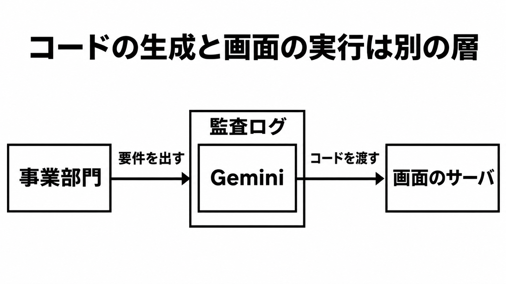

# ダイジェスト: 内製の許可書は引き受け先を空欄にしない

[元記事](../../../../../articles/it-gemini-kn-itmedia-co-jp-p8_20261116.md)

## ひとことで言うと

内製を認める文書は、完成月数とは別に、実行の所有者、障害の一次受け、改修の所有者を空欄にしません。

## 核心ポイント

- 非ITの運輸部担当者が、Gemini（文章やコードを出すAI）の出力を検証しながら画面を作りました。
- 画面の実行は、Geminiの監査ログの外です。
- 実行の所有者、障害の一次受け、改修の所有者は、公開本文にありません。

## メンタルモデル

左から右へ、要件、コード、画面の順に読みます。
中央の枠は、監査ログの範囲です。

## 具体例

乗客を乗せている間の車両データは、画面で見ています。
この画面は、定期検査を置き換える前の検証です。
検査そのものは、今も一定間隔で続いています。

## 適用と判断

向く場面:

- 非IT部門に画面の内製を認める前です。
- 完成月数の実績だけで本番継続を決めるときです。
- 影響が作った部署の外へ出る画面のときです。

確認すること:

- 実行の所有者は書いてありますか。
- プロンプトへ貼ってよいかは書いてありますか。
- 障害の一次受けは書いてありますか。
- 改修の所有者は書いてありますか。
- 定期検査の代わりになる機能は、試作のままですか。

## 限界・注意点

- 完成までの月数は、測定方法のない自己申告です。
- 公開資料に無いことを、社内に取り決めが無いこととしては扱いません。
- Geminiの出力は、法令上の義務を満たす設計ではありません。

## 参考

- 元記事: [it-gemini-kn-itmedia-co-jp-p8_20261116.md](../../../../../articles/it-gemini-kn-itmedia-co-jp-p8_20261116.md)
- [Google Workspace 顧客事例「JR九州」（2026-10-30）](https://workspace.google.com/blog/ja/customer-stories/jr-kyushu-implements-google-workspace-with-gemini)
- [Geminiの監査ログ](https://knowledge.workspace.google.com/admin/gemini/generative-ai-in-google-workspace-privacy-hub?hl=en)
- [Geminiの出力は法令上の義務を満たす設計ではない](https://workspace.google.com/intl/ja/terms/service-terms-20260716/)
- [画面を動かすサーバの仕組み](https://docs.streamlit.io/develop/concepts/architecture/architecture)
