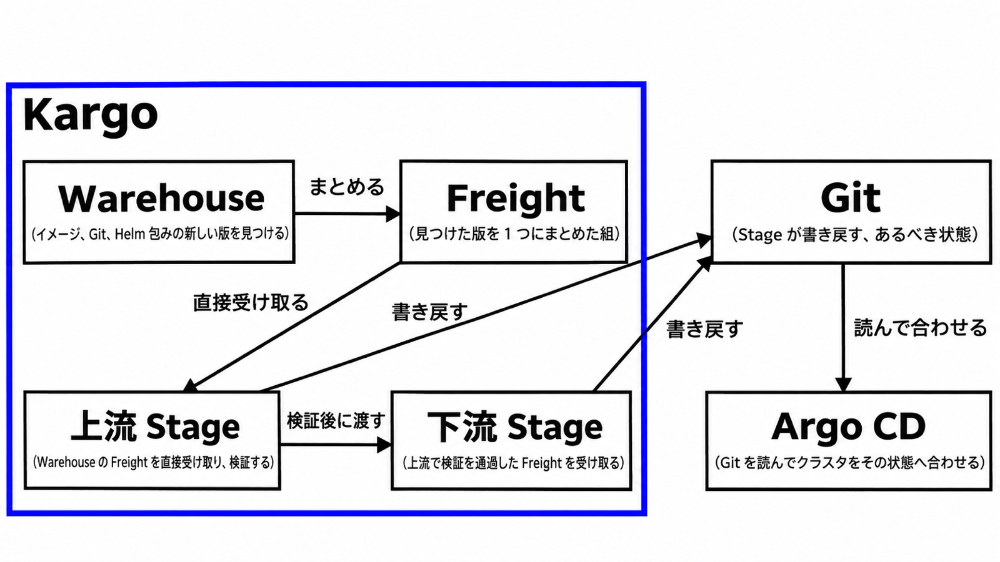

# ダイジェスト: 成果物の組を Stage の列で進める

[元記事](../../../../../articles/kargo_20261116.md)

## ひとことで言うと

Kargo は成果物の組を Stage の列で進め、クラスタへの同期は Argo CD に任せます。

## 核心ポイント

- Warehouse はイメージ、Git、Helm 包みを 1 つの Freight にします。
- 下流の候補になるのは、上流で検証を通過した Freight です。
- 待ち時間を課したときだけ、上流に載り続けた時間がそれに達するまで下流へ出せません。
- 自動で進めるかは ProjectConfig（進めるかの設定）で決め、省略すると進みません。
- クラスタを Git に合わせ続けるのは Argo CD か Flux です。

## メンタルモデル

青い枠の中が Kargo です。Git と Argo CD は枠の右の外です。

## 具体例

test は Warehouse の Freight を直接受け取ります。uat は test で検証を通過した Freight だけを受け取ります。プロモーション手順を書くと、Stage 用ブランチへあるべき状態を書き、Argo CD に同期させます。

## 適用と判断

向く場面:

- 同じ成果物の組を dev から本番まで規則どおり進めます。
- 環境間コピーを CI のジョブから Stage の定義へ移します。
- モノレポでアプリごとに監視するパスを分けて進めます。

確認すること:

- 低い環境だけ自動で進むようにしましたか。
- 書き戻し先を、Warehouse が見る対象から外しましたか。
- 本番の前に上流での待ち時間を置きましたか。
- 失敗から戻すときは、人がその Stage へ載せ直す手順にしましたか。

## 限界・注意点

- 自動ロールバックと時間帯の窓は、OSS では無視されることがあります。動くかはクラスタで確認します。
- 出力パスを Warehouse が見ていると、書き戻しのたびに新しい Freight が生まれます。
- 成否の検査を書くときは、Argo Rollouts（検査の定義元）が要ります。無いと、その Stage の検証は失敗します。
- 手動承認した Freight は、その Stage では上流の検証と待ち時間を飛ばせます。
- 本番トラフィックの割合を広げるのは Argo Rollouts です。

## 参考

- 元記事: [kargo_20261116.md](../../../../../articles/kargo_20261116.md)
- [Kargo ドキュメント](https://docs.kargo.io/)
- [akuity/kargo](https://github.com/akuity/kargo)
- [Release v1.12.5](https://github.com/akuity/kargo/releases/tag/v1.12.5)
