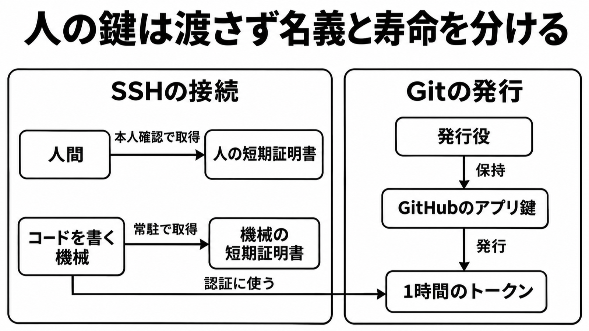

# ダイジェスト: 人のSSH鍵をエージェントに渡さない資格情報の分離

[元記事](../../../../../articles/ssh-speakerdeck-atalie2m-p6_20261116.md)

## ひとことで言うと

この記事は、コードを書く機械を、非rootの別OSユーザーの短期SSH証明書で入れます。

## 核心ポイント

- 接続先が信頼するのは、証明書に署名した認証局です。
- 機械は、非rootの別OSユーザーと、人とは別の短期証明書で入ります。
- 機械向けの資格情報は、Teleport（証明書で入る基盤）の既定で1時間、20分ごとに更新します。
- 機械向けの資格情報をディレクトリへ書くと、秘密鍵ファイルも残ります。
- GitHubのアプリ鍵は発行役に残ります。機械のGit認証に使うのは、1時間のトークンです。

## メンタルモデル

左の枠はSSHの接続、右の枠はGitの発行です。下の矢印は、機械がトークンを認証に使う向きです。

## 具体例

接続例のログイン名は domus-coding-agent です。資格情報の場所は ./bot/identity です。人の秘密鍵の場所は、この例にありません。

## 適用と判断

向く場面:

- 人と機械が同じサーバへSSHするときです。
- GitHubのアプリ鍵を、機械のディスクに置かないときです。
- 今の認証局の短いSSH証明書だけでは、足りないときです。

確認すること:

- 更新を止めても、発行済み証明書を無効化しますか。
- ディレクトリへ書いた資格情報を、機械のプロセスだけが読めますか。
- 署名鍵を、人のSSH認証鍵とは別の鍵にしていますか。
- 基盤停止の単一障害点を、受け入れると決めましたか。

## 限界・注意点

- 30秒などの期限は、実装未確認の自己申告です。
- コマンドごとの許可は、今後の課題です。
- アプリ鍵とは別のコミット署名鍵は、種類、寿命、置き場所が不明です。
- 監査が画面の収録か、コマンド単位かは、未確認です。
- 1時間の証明書は、ゼロトラストの定義そのものではありません。

## 参考

- 元記事: [ssh-speakerdeck-atalie2m-p6_20261116.md](../../../../../articles/ssh-speakerdeck-atalie2m-p6_20261116.md)
- [さようならSSH鍵、こんにちはゼロトラスト](https://speakerdeck.com/atalie2m/goodbye-ssh-key-jisabakan-2026)
- [Machine & Workload Identity Configuration](https://goteleport.com/docs/reference/machine-workload-identity/configuration/)
- [Generating an installation access token](https://docs.github.com/en/apps/creating-github-apps/authenticating-with-a-github-app/generating-an-installation-access-token-for-a-github-app)
- [NIST CSRC Glossary, Zero Trust](https://csrc.nist.gov/glossary/term/zero_trust)
