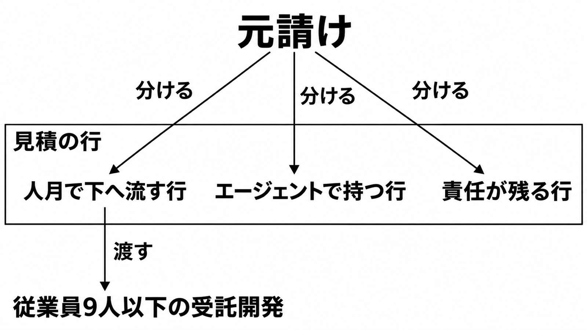

# ダイジェスト: 見積は三つの行に分ける

[元記事](../../../../../articles/xtech-nikkei-atcl-nxt-column-p5_20261116.md)

## ひとことで言うと

2026年の情報サービス業は、売上と大手受注が伸び、倒産は従業員9人以下に集中し、上期は10年で最多ペースです。

## 核心ポイント

- 売上と大手の受注が伸びる時期に、負債1,000万円以上の法的倒産は従業員9人以下の受託開発へ集まっています。
- 暦年上期は166件、年度上期は174件です。どちらも10年でその期間の最多で、年度の月は原文にありません。
- 確認した大手2社の上期説明資料に、外注費の行はありません。中小への発注が減ったとは書けません。
- 見積の分け方は、次の三行です。人月で下へ流す行、エージェントで持つ行（コード生成などを内製）、責任が残る行（要件の受け入れなど）です。

## メンタルモデル

元請けから三つの行へ矢印が出ます。従業員9人以下へ続くのは、人月で下へ流す行だけです。

## 具体例

システムを使う側の企業の調査では、設計・実装・テストを外部へ出す企業の割合が63.4%です。これは企業数の割合で、従業員9人以下へ渡る割合ではありません。

## 適用と判断

向く場面:

- 見積を、三つの行に分けて出します。
- 下請けの稼働を前提にした工期を、そのまま使いません。
- 倒産件数を、崩れた量として計画に使いません。

確認すること:

- 下へ流す行だけを、人月にしていますか。
- コード生成などの作業だけを、エージェントで持つ行にしていますか。
- 責任が残る行を、人月を削った余りとして消していませんか。
- 自社支援で出た工数削減を、ほかの行の係数にしていませんか。
- 取適法（中小受託の法律）の線なら、書面と支払期日を残していますか。

## 限界・注意点

- 2026年通年の最多は、まだ確定していません。2025年通年の284件は、別の集計の最多です。
- 70%は自社支援の工数削減の上限です。30%は設計からテストの削減目標で、原文は未確認です。
- 業界団体の調査では、2024年度まで外注費率が上がっています。人月の行が消えた証拠にはなりません。
- 倒産の原因は、調査ごとに違います。販売不振、簡易な開発の内製化、多層委託で賃上げを転嫁できないことが並びます。
- 実装、試験、移行、結合の工程別の時間は、測られていません。

## 参考

- 元記事: [xtech-nikkei-atcl-nxt-column-p5_20261116.md](../../../../../articles/xtech-nikkei-atcl-nxt-column-p5_20261116.md)
- [日経クロステック公開リード（2026年11月16日）](https://xtech.nikkei.com/atcl/nxt/column/18/03792/110500001/)
- [東京商工リサーチ、2026年7月14日](https://www.tsr-net.co.jp/data/detail/1203052_1527.html)
- [東京商工リサーチ、2026年10月27日](https://www.tsr-net.co.jp/data/detail/1203376_1527.html)
- [JUAS『企業IT動向調査報告書2026』](https://juas.or.jp/cms/media/2026/04/JUAS_IT2026.pdf)
