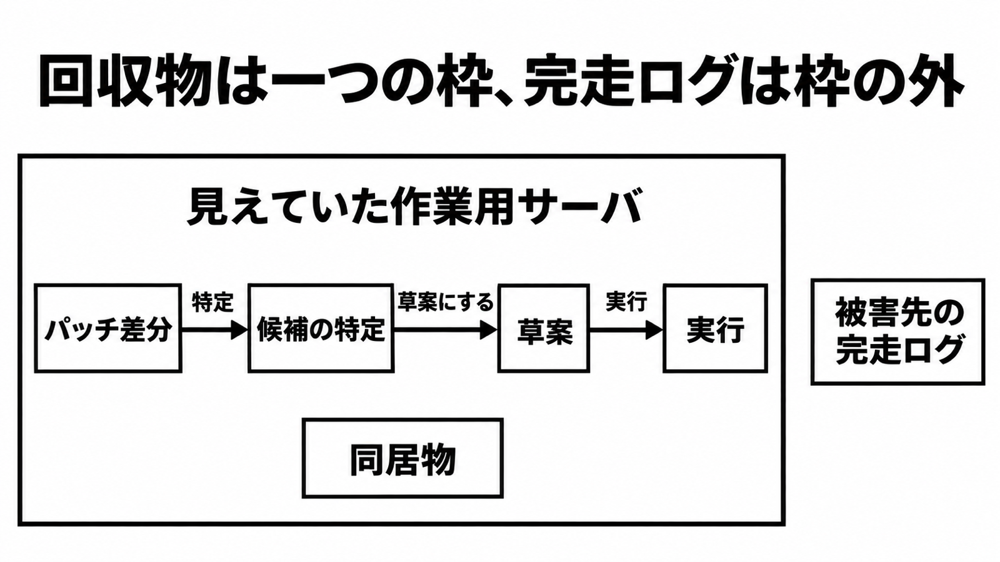

# ダイジェスト: 差分から実行までを一つの構成として読む

[元記事](../../../../../articles/google-cloud-google-topics-p1_20261117.md)

## ひとことで言うと

Googleの脅威調査は、攻撃側の処理を、差分から人の介在なしの実行までの一つの構成として観測しました。

## 核心ポイント

- exploit_agent は、見えていた作業用サーバ上で、複数の言語モデルへつながる枠組みの名前です。順は、パッチ前後の差分、脆弱性の候補、草案、実行です。
- 同じサーバに、持ち出されたデータ、侵害後のスクリプト、被害側の記録がありました。
- 初めて確認したのは、発見と実行の両方を人の介在なしで進める枠です。範囲はこの調査の追跡の中で、業界の先行の有無までは含みません。
- サーバ上の記録が示すのは、データがあったことと、フランスのメディア・エンタメと教育のサイトへの関心の推定です。被害先で工程が終わったログではありません。

## メンタルモデル

枠の中の下の箱は、同じサーバにあったデータと記録です。
枠の外へは、矢印がありません。

## 具体例

この枠組みが検査していた対象の例は、WordPress のプラグイン Spectra 2.19.25 です。検査していたのは、そのアクセス制御です。

## 適用と判断

向く場面:

- 同じサーバの回収物では、スキャン、侵入、資格情報の使用を一つの案件にします。
- パッチのあと、人の操作なしの実行が公開アプリへ向かうかを見ます。

確認すること:

- 結ぶ単位を、同じサーバの回収物にしましたか。
- 被害先のログを、この構成の証拠から外しましたか。
- 「初めて」を、その追跡の中の確認に置きましたか。

## 限界・注意点

- 被害先で工程が終わったログの種類は、公開記事にありません。
- 実行前にファイルへ置く鍵は、実行中の介入を示しません。
- 侵害の件数は、公開記事にありません。
- 同じ中身を、別の組織が公開資料で確認したかは、分かっていません。

## 参考

- 元記事: [google-cloud-google-topics-p1_20261117.md](../../../../../articles/google-cloud-google-topics-p1_20261117.md)
- [Google Cloud Blog「Agentic Threat Activity Crosses a Significant Threshold」（2026-11-16）](https://cloud.google.com/blog/topics/threat-intelligence/agentic-threat-activity-crosses-a-significant-threshold/)
