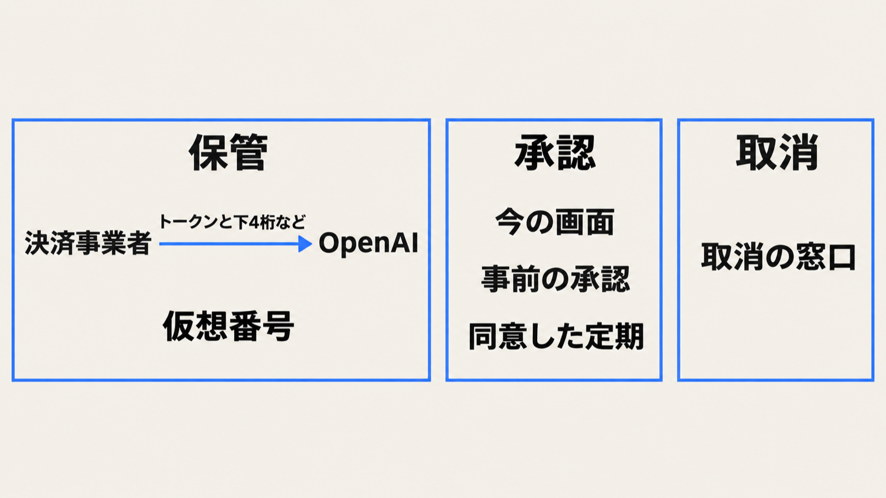

# ダイジェスト: 保管、承認、取消の三つで読む ChatGPT Wallet

[元記事](../../../../../articles/openai-chatgpt-wallet-pro-p4_20261117.md)

## ひとことで言うと

ChatGPT Walletは印字された番号を店へ渡さず、承認後の仮想番号で支払います。

## 核心ポイント

- OpenAIの受領範囲に、印字された番号の全桁は入りません。集めるのは決済事業者です。
- 承認後に店のフォームへ入るのは、仮想番号（印字された番号の代わり）です。
- 今の画面は表示された一回の確認だけで、上限、品目、期間を事前に置く画面は手順の説明にありません。
- 利用契約は、あらかじめ承認を任せることを含みます。
- 店は、同意した定期の資格を保存して再び請求できます。

## メンタルモデル

左から保管、承認、取消の枠です。保管の矢印は上段の受け取りを指します。

## 具体例

利用者は、決済事業者が番号を集めるフォームでカードを登録します。購入前に店、品目、合計、使うカードを確認し、対応端末で生体認証します。承認後の番号は、選んだカードへの請求に使われます。

## 適用と判断

向く場面:

- エージェントに支払いを任せる設計を読みます。
- この Wallet の導入可否を文書で判断します。
- あらかじめ承認を任せる設計を読みます。

確認すること:

- 全桁の受領先を、OpenAIと決済事業者で分けて書きましたか。
- 店へ渡すのが印字された番号か別番号かを分けましたか。
- 上限の画面が無いことと、事前に任せる承認を分けましたか。
- 定期の再請求の主体が店かを確認しましたか。
- 承認後の取消を、店と発行者で分けましたか。

## 限界・注意点

- 対象は米国在住18歳以上のPro（有料プランの名前）より狭く、機能が未表示のこともあります。カードは米国発行かつ米国の請求先で、使えるのは支払いの会話だけです。
- 登録時のトークン（全桁の代わり）と、承認後の仮想番号が同一かは未記載です。
- 承認完了の表示のあとでも、店が注文を受けたとは限りません。
- 取消の窓口は、成立した注文なら店、保留や身に覚えのない請求なら発行者です。
- 仮想番号が会話本文に残るかは未記載です。

## 参考

- 元記事: [openai-chatgpt-wallet-pro-p4_20261117.md](../../../../../articles/openai-chatgpt-wallet-pro-p4_20261117.md)
- [OpenAI Help, Making purchases with ChatGPT Wallet](https://help.openai.com/en/articles/20001654-making-purchases-with-chatgpt-wallet)
- [ChatGPT Wallet Privacy Notice](https://openai.com/policies/chatgpt-wallet-privacy-notice/)
- [ChatGPT Wallet terms](https://openai.com/policies/chatgpt-wallet-terms/)
- [OpenAI Developers, Accept payments](https://developers.openai.com/commerce/guides/accept-payments.md)
