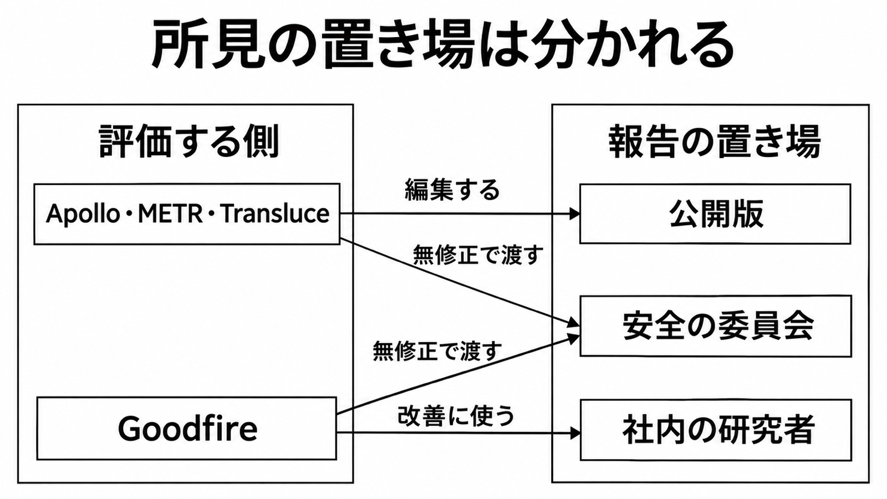

# ダイジェスト: 訓練中と社内のモデルを4組織で見る

[元記事](../../../../../articles/openai-openai-index-our-first-p2_20261117.md)

## ひとことで言うと

OpenAIは、4組織が訓練中と社内のモデルを期間を限って見ると合意しました。

## 核心ポイント

- Apolloは、そのモデルか次のモデルへの制御を外そうとするかを見ます。
- METRは、最大の強化学習の実行1本の不整合（アライメントが外れた状態）を見ます。既存の検査と監視が見逃した失敗も含みます。
- Goodfireは、訓練中の内部を、振る舞いの記録とは別に見ます。
- Transluceは、訓練後の評価の範囲と質を見ます。
- 評価者は、訓練や出荷を止められません。不同意は期限内に Safety Advisory Group と幹部へ上がり、残りは安全の委員会が解決します。

## メンタルモデル

左から右へ読みます。左が評価する側で、右が報告の置き場です。

## 具体例

Apolloは6人で4か月です。訓練を見る分では、関連するコードとデータ、推論の記録、強化学習の一連の出力、途中モデルへの問い合わせを扱えます。ほかは未合意で、範囲の内でも技術的にできないとき、セキュリティ、知的財産では保留でき、不利だからだけでは保留しません。

## 適用と判断

向く場面:

- 危険な振る舞いを報いるかは、コード、データ、一連の出力、途中モデルで見ます。
- 評価が本番を代表するかは、定義と結果と記録で見ます。

確認すること:

- 実行、評価一式、監視記録、話せる人を事前に書きましたか。
- 不同意の上げ先を、実装チームの外に書きましたか。
- 不同意の期限を書きましたか。
- 出せない範囲の理由を、書面で残しましたか。
- 公開版に、削除が結論へ影響したかを書けるようにしましたか。

## 限界・注意点

- 2026年11月16日時点で、4件の評価結果は出ていません。
- METRの別の監視は、広げる方向で暫定合意され、範囲は相互の合意待ちです。
- 社員に近い水準を満たした文は、この合意にありません。
- Transluceが公開できるのは、公開済みモデルの評価です。会話は、認められた文だけ出せます。
- 2027年前半のTransluceとの後続では、OpenAIがリリース判断の入り方を見ます。その詳細は未確定です。

## 参考

- 元記事: [訓練中と社内のモデルを4組織で見る](../../../../../articles/openai-openai-index-our-first-p2_20261117.md)
- [OpenAIの発表（2026-11-16）](https://openai.com/index/our-first-phase-of-embedded-assessments/)
- [Apolloの発表（2026-11-16）](https://www.apolloresearch.ai/blog/pilot-towards-embedded-evaluations)
- [Transluceの発表（2026-11-16）](https://transluce.org/embedded-assessment-pilot-with-openai)
- [OpenAIの第三者評価の原則（2026-09-22）](https://openai.com/index/priorities-principles-third-party-assessments/)
