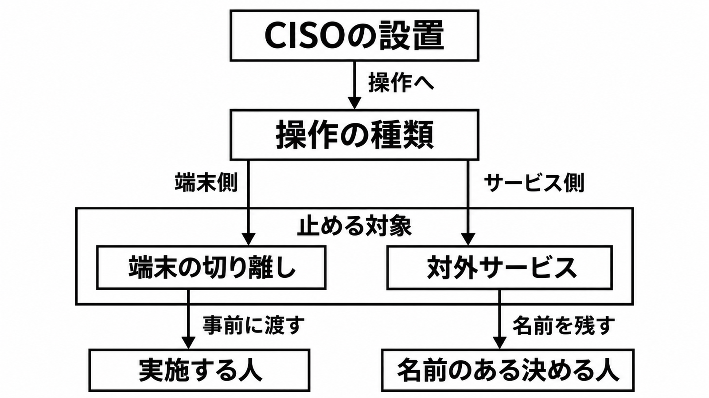

# ダイジェスト: CISOを置いただけでは、対外サービスを止める権限は肩書へ移ったと読めない

[元記事](../../../../../articles/ciso-xtech-nikkei-atcl-nxt-p8_20261118.md)

## ひとことで言うと

CISO（セキュリティ責任者）を置いただけでは、対外サービスを止める権限はその肩書へ移ったとは読めません。

## 核心ポイント

- 設置は役職を置くことです。停止の権限は、操作ごとに実施する人と上限時間を別の欄へ書きます。
- 渡せるのは端末の切り離し、マルウェア隔離、感染コンテナの停止です。人か自動措置が、その権限と戻す条件と上限時間を平時の文書で持つときに限ります。
- 対外サービスと、先に停止を検討するシステムの停止は、名前を書いた決める人へ残します。
- この分け方は、この記事の設計案です。
- CISOの名前を書くのは、その操作の実施する人か決める人として文書にあるときだけです。

## メンタルモデル

上から設置、操作の種類、止める対象、人です。
止める対象の左が端末の切り離し、右が対外サービス、人の左が実施する人、右が決める人です。

## 具体例

GMOの公開記録には、新規申し込みを止めた事実があります。
決める人の氏名も、CISOがいたかも書いてありません。

## 適用と判断

向く場面:

- 有事の停止権限を、操作ごとに表へ書くときです。
- 対外サービスの停止を、平時に名前で残すときです。
- 最初の連絡先で、実施する人と決める人を分けるときです。

確認すること:

- 端末の切り離しを戻す条件は、平時に書いてありますか。
- 対外サービスの停止を決める人の名前がありますか。
- 実施する人と決める人が違うとき、引継ぎの経路がありますか。
- 自動で止めるとき、人が覆す条件がありますか。
- 再開を決める人の名前は書いてありますか。

## 限界・注意点

- 設置率57.5%は、日経の図の説明がそう書く範囲までです。設問の定義は未照合です。
- 日経本文の続きは未確認です。日経がどの結論にしたかは、この範囲外です。
- 金融庁と日本銀行の要請は、金融機関等の文書です。全産業の法令としては読みません。
- 端末を切り離す権限を、セキュリティ責任者の職務として書いている文書はあります。その文書に、対外サービスの停止時間と、再開を決める人はありません。
- 停止の記録だけでは、権限が無かったとは読めません。

## 参考

- 元記事: [ciso-xtech-nikkei-atcl-nxt-p8_20261118.md](../../../../../articles/ciso-xtech-nikkei-atcl-nxt-p8_20261118.md)
- [日経クロステック（公開部分）](https://xtech.nikkei.com/atcl/nxt/column/18/00138/111202148/)
- [金融庁・日本銀行 要請 PDF](https://www.fsa.go.jp/news/r7/sonota/20260522-5/01.pdf)
- [NIST SP 800-61r3](https://doi.org/10.6028/NIST.SP.800-61r3)
- [UTRGV ISO-100-S1](https://www.utrgv.edu/is/forms-and-policies/policies/ciso-investigative-access-authority-standard/index.htm)
