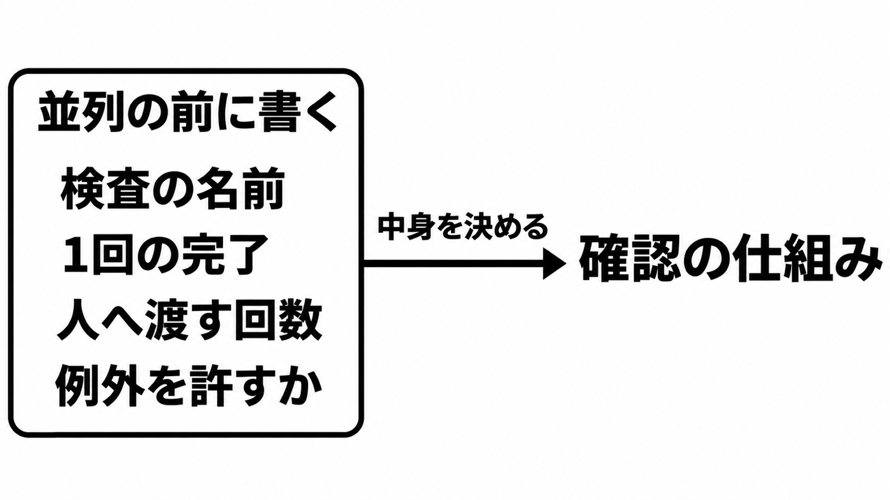

# ダイジェスト: 並列の前に書く検査と失敗の渡し方

[元記事](../../../../../articles/claude-code-e2e-claude-dev-p5_20261118.md)

## ひとことで言うと

この解説は、並列の前に検査の名前と失敗の渡し方を自分で書くよう求めています。

## 核心ポイント

- 人が変更を全部見なくても確認を続けられる仕組みが無いとき、同時に動かすエージェントは1つか2つです。
- 1種類なら E2E（操作の一連）を選びます。
- プロパティテストと差分テストの間に、順位はありません。
- アプリを最後まで動かすことを、テストより上に置きます。
- チームは、失敗が続いた検査を、3回のあとでも失敗なら人へ渡します。1回が、修正か、検査の実行か、レビューの往復かは未定義です。

## メンタルモデル

左の枠が、並列の前に書く4つです。4つ目は具体例の2文で、矢印は右の確認の仕組みへ向かいます。

## 具体例

セッション内で、検証の無い commit を2回止めたら、次の commit は通します。原因が分からない不安定なテストは、消して理由を残します。

## 適用と判断

向く場面:

- エージェントの並列数を増やす前です。
- 失敗した検査を人へ渡す規則を書きます。
- 記事の回数を自分の通過条件にする前です。

確認すること:

- ゲートにする検査の名前を書きましたか。
- 1回の完了を、自分で定義しましたか。
- 人へ渡す回数を自分で書きましたか。

## 限界・注意点

- 約90%は、書く割合と、書いてレビューした割合の、別々の文です。どちらも自己申告で、分母は文章にありません。
- 最大10ポイントは、別対象の内部テストで、通常のプロンプトの往復よりタスク成功が上がった幅の自己申告の上限です。標本数と分母は、文章にありません。
- 失敗した検査の3回は、製品の既定ではありません。レビュー記事の3回は、著者に再考を求める回数です。
- 人へ渡す3回は、一時的な失敗の再試行とは別です。
- 39項目の中身と、止める仕組みの off と observe の動作は、公開ページにありません。

## 参考

- 元記事: [claude-code-e2e-claude-dev-p5_20261118.md](../../../../../articles/claude-code-e2e-claude-dev-p5_20261118.md)
- [How the Claude Code team thinks about verification](https://claude.dev/blog/how-the-claude-code-team-thinks-about-verification/)
- [How the Claude Code team does code review](https://claude.dev/blog/solving-code-review-at-anthropic.md)
- [Claude Managed Agents](https://claude.com/blog/claude-managed-agents)
- [Code Review](https://code.claude.com/docs/en/code-review)
