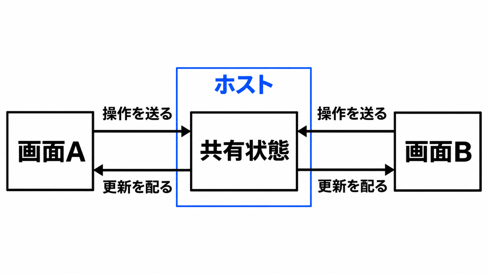

# ダイジェスト: 複数画面が同じセッションを共有する

[元記事](../../../../../articles/github-agent-host-protocol-p2_20261118.md)

## ひとことで言うと

Agent Host Protocol は、複数の画面がホスト上の同じセッションを同じ状態で見る規格です。

## 核心ポイント

- 状態の権威はホストにあります。
- 画面は状態を購読し、操作で更新します。
- 自分の操作は先に画面へ出し、ホストが返した同じ操作で確定します。
- 再接続の応答では、未確定の操作を捨ててホストの状態に合わせます。
- 認可の証は、画面ごとにホストへ渡します。共有の状態には入りません。

## メンタルモデル

左と右が画面、中央の枠がホストです。矢印は操作の送信と、更新の配信です。

## 具体例

承認を待っている 1 件は、画面のあいだで共有されます。別の画面が先に承認すると、その 1 件が有効です。後から送った承認は拒否されます。

## 適用と判断

向く場面:

- 複数の画面で同じセッションを見ます。
- 切れた接続から同じセッションへ戻ります。
- 別の画面へ承認を移します。

確認すること:

- 画面がホストへ、実装した版だけを示しますか。

## 限界・注意点

- 文書例の 0.3.0 は現行の版ではありません。公開タグは 1.1.0 です。
- 承認を移したくないセッションには、別の画面を購読させません。
- 1 つの画面からエージェントを直接動かす用途は、この規格の外です。
- Kotlin の例は、公開の配布物が見つかりませんでした。使う前に配布元を見ます。

## 参考

- 元記事: [github-agent-host-protocol-p2_20261118.md](../../../../../articles/github-agent-host-protocol-p2_20261118.md)
- [Building the Agent Host Protocol](https://github.blog/engineering/engineering-principles/building-the-agent-host-protocol-for-sessions-that-continue-across-devices/)
- [microsoft/agent-host-protocol](https://github.com/microsoft/agent-host-protocol)
- [ドキュメント](https://microsoft.github.io/agent-host-protocol/)
- [Write-Ahead Reconciliation](https://microsoft.github.io/agent-host-protocol/guide/reconciliation)
