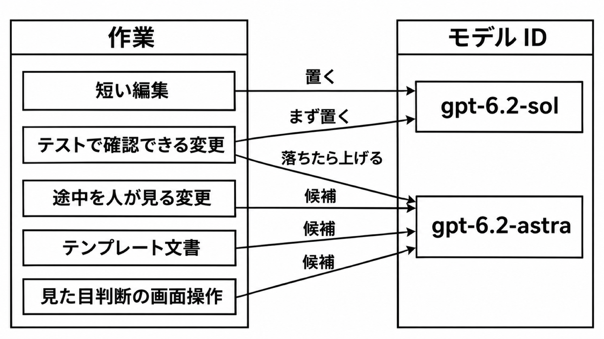

# ダイジェスト: AstraとSolを作業で分ける

[元記事](../../../../../articles/openai-gpt-6-2-astra-sol-p1_20261118.md)

## ひとことで言うと

OpenAIのGPT-6.2は、最も要求の高い作業をAstra、低コストの複雑作業をSolに置きます。

## 核心ポイント

- モデル ID は gpt-6.2-astra と gpt-6.2-sol です。gpt-6-astra を残すと前世代が動きます。
- 短い編集は Sol に置きます。テストで確認できる中程度の変更はまず Sol で試し、テストと差分で落ちたら Astra に上げます。
- テンプレートどおりのスライド、表、文書は Astra の候補です。区切りをまたぐ既存コードは、途中を画面か長い差分で人が見るとき候補です。
- 見た目が主でない画面操作は Sol に置き、権限とレビューは Astra と同じです。視覚判断の画面操作は Astra の候補です。
- 通常料金で、入力 272,000 トークン以下なら、Sol の入力単価と出力単価は Astra の 4 分の 1 です。取得日は 2026-11-18 です。

## メンタルモデル

左の図にある作業から、右のモデル ID へ矢印を追います。「落ちたら上げる」は、テストと差分で落ちたあとの矢印です。

## 具体例

リポジトリ内の関数を 1 つ直し、テストが緑なら完了です。モデル ID は gpt-6.2-sol です。

## 適用と判断

向く場面:

- モデル ID を書く箇所を決めるときに使います。
- 画面操作の実行者を書き分けるときに使います。
- 長い入力の単価を見積もるときに使います。

## 限界・注意点

- FrontierCode 2.0 の最大設定では、Sol の費用は Astra の約 5 分の 1 です。掲載側の自己申告で、公開単価の比とは別です。
- 入力が 272,000 を超えると、リクエスト全体にそれ以下の単価の倍率をかけます。入力と、再利用する入力の読取が 2 倍、出力が 1.5 倍です。
- 速度を上げる高速料金（Ultrafast）のプロモ単価は、2027-02-28 太平洋時間までです。その翌日からのリスト価格は別です。
- 用意したブラウザやデスクトップは、呼び出し側が操作します。許可した画面は、ChatGPT のデスクトップが操作します。
- reasoning effort（考えさせる量）の high 以上は、両モデルで未確定です。拒否と明記があるのは none（無しの値）だけです。

## 参考

- 元記事: [openai-gpt-6-2-astra-sol-p1_20261118.md](../../../../../articles/openai-gpt-6-2-astra-sol-p1_20261118.md)
- [OpenAI, Introducing GPT-6.2 Astra and Sol](https://openai.com/index/introducing-gpt-6-2-astra-sol)
- [OpenAI, Pricing](https://developers.openai.com/api/docs/pricing.md)
- [OpenAI, Computer use](https://developers.openai.com/api/docs/guides/tools-computer-use.md)
- [OpenAI, Computer Use（ChatGPT Work / Codex）](https://learn.chatgpt.com/docs/computer-use)
- [OpenAI, GPT-6.2 System Card](https://deploymentsafety.openai.com/gpt-6-2-astra-sol)
