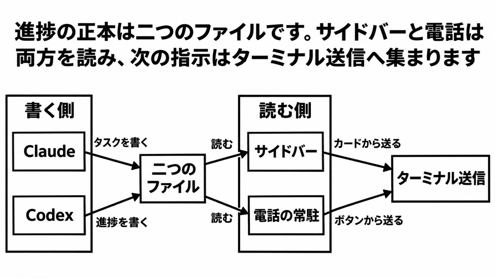

# ダイジェスト: 進捗ファイルを読み、カードで次を送る

[元記事](../../../../../articles/orca-milestone_20261118.md)

## ひとことで言うと

Orca のプラグイン Milestone は、進捗を集め、カードで次の指示を送ります。

## 核心ポイント

- Claude の進捗は、Claude が手元に書くタスクファイルです。
- Codex の進捗は、起動時に足した処理が書く JSON です。
- ターンが変わったカードは送りません。
- 起動時に足すのは、そのセッションのコマンドと環境変数だけです。
- Mac 上の電話向け常駐は、Claude と Codex のファイルを読みます。

## メンタルモデル

中央の箱は、二つのファイルを図の上で一つに描いたものです。

## 具体例

生きているメインが 1 つで、状態が done、アーカイブされていないときだけ、末尾の next をカードにします。押すと、その時点の返信から依頼文を読み直して送ります。送るコマンドは orca terminal send です。

## 適用と判断

向く場面:

- 複数 worktree のゴールと未完了を 1 枚で見ます。
- 返答が終わって待っているセッションへ、候補を 1 つ送ります。
- 外出先でタスクの件数と状態だけ見るときは、電話の常駐を使います。

確認すること:

- 新しいセッションを Orca のターミナルから起動しましたか。
- 依頼文はサイドバーか電話のボタンだけで送りますか。
- エージェントの読み取りと書き込みだけを、そのターンでまとめて許しますか。
- 手順に書く版を、配布版と新しいソースで分けましたか。

## 限界・注意点

- 起動時の足し込みは、すでに動いているセッションには掛かりません。
- 必要な Orca は 1.4.248 以上で、1.4.247 は範囲外です。
- 入力欄に文字があると、Codex への提案は送りません。
- 同じタブの Claude を代表へまとめるのは、新しいソースのチーム起動だけです。
- iPhone アプリのソースは、2026-11-18 時点の公開先が見つかりません。

## 参考

- 元記事: [orca-milestone_20261118.md](../../../../../articles/orca-milestone_20261118.md)
- [andoshin11/orca-milestone](https://github.com/andoshin11/orca-milestone)
- [andoshin11/agent-status-panel](https://github.com/andoshin11/agent-status-panel)
- [stablyai/orca](https://github.com/stablyai/orca)
