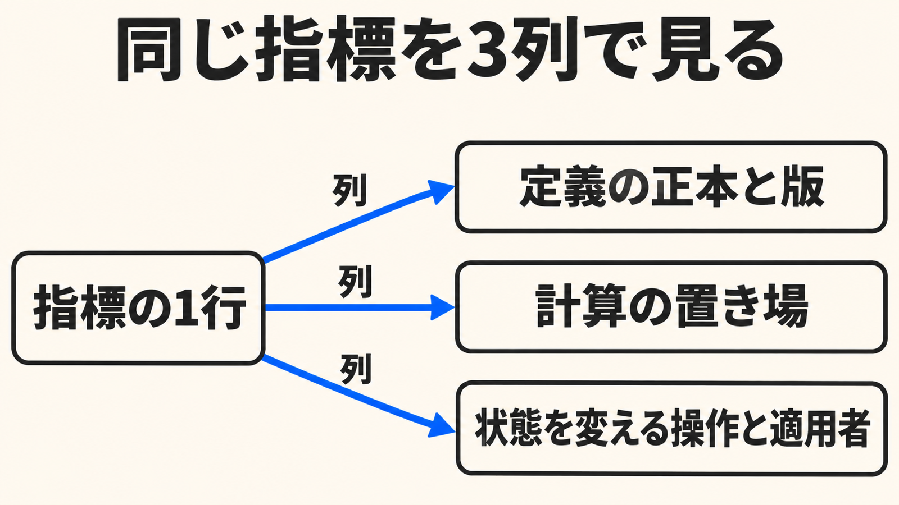

# ダイジェスト: 業務の言葉を渡す層の置き場

[元記事](../../../../../articles/atmarkit-itmedia-co-jp-ait-p1_20261119.md)

## ひとことで言うと

Palantir など5社が業務の言葉をエージェントへ渡す層は、定義と計算と操作の置き場が分かれます。

## 核心ポイント

- 見る単位は、指標ごとの1行です。
- 行には、定義の正本と版、計算の置き場、状態を変える操作と適用者（操作できる人）を並べます。
- Palantir は、状態を変える操作を層の中に置きます。
- Snowflake、Databricks、NVIDIA、Microsoft は、その操作を層の外に置きます。

## メンタルモデル

左が指標の1行です。右の3箱が列で、矢印も列を指します。

## 具体例

Snowflake では、承認した業務の言葉が定義の正本です。計算の定義は指標用のビューにあり、この層はその計算を変えません。その層は、2026年11月3日時点で private preview、public preview は soon です。

## 適用と判断

向く場面:

- 操作と権限を層の中に置き、外へ書き戻すなら、Palantir の資料を見ます。
- 言葉の承認を計算より前に置くなら、Snowflake の資料を見ます。
- 読み取りだけをこの層に置くなら、NVIDIA の資料を見ます。

## 限界・注意点

- 3列をまたいで、複数の製品を組み合わせてよいです。
- 人の承認は、回答のたびに未承認を止める保証ではありません。
- Databricks では、書き込み前の都度承認は一部だけです。
- NVIDIA の Auto-Ontology（概念へ写すライブラリ）の質問は、SELECT 以外を拒むか未確認です。更新を止める場所にはしません。
- Webhook 失敗時に、Palantir 側のオブジェクト編集が戻るかは未確認です。書き戻しを1トランザクションとはみなしません。

## 参考

- 元記事: [atmarkit-itmedia-co-jp-ait-p1_20261119.md](../../../../../articles/atmarkit-itmedia-co-jp-ait-p1_20261119.md)
- [@IT、一色政彦（2026年11月19日）](https://atmarkit.itmedia.co.jp/ait/articles/2611/19/news008.html)
- [Palantir, Why Ontology](https://palantir.com/docs/foundry/ontology/why-ontology/)
- [Snowflake, Business Ontology](https://www.snowflake.com/en/blog/business-ontology-context/)
- [NVIDIA/auto-ontology#268](https://github.com/NVIDIA/auto-ontology/issues/268)
