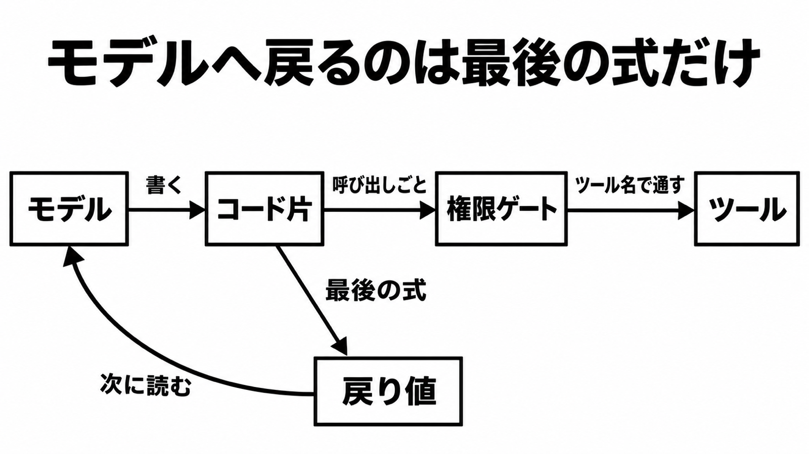

# ダイジェスト: Code Mode はツール呼び出しを JavaScript にまとめる

[元記事](../../../../../articles/claude-code-mode_20261119.md)

## ひとことで言うと

Claude Code の Code Mode は、ツール呼び出しを JavaScript にまとめる実験機能です。

## 核心ポイント

- オンにする変数は CLAUDE_CODE_EXPERIMENTAL_CODE_MODE です。場所は、シェル、ユーザー設定、起動時に渡すファイルだけです。
- 既定はオフです。0 が他の 1 より優先するのは、シェル、ユーザー設定、起動時に渡すファイル、管理設定です。
- 各呼び出しは、Bash などのツール名で拒否と確認のルールと、実行前フックを通ります。
- auto mode（確認を減らす権限）の分類器はコード片を実行前に見るので、実行時に計算した値は見えません。
- 公開されている形は、検索して編集し、最後の式だけを返す 1 例です。

## メンタルモデル

図の権限ゲートは、拒否と確認のルールと、実行前フックです。戻り値からモデルへ戻る矢印があります。

## 具体例

公式例は、retryPolicy を含むファイルを検索します。先頭のファイルで、maxAttempts を 3 から 5 へ替え、テストを走らせます。Claude に戻るのは、編集したパスとテスト結果だけです。

## 適用と判断

向く場面:

- 多数のファイルへ同じ変更を繰り返すときです。
- 検索結果を絞ってから読ませるときです。
- 独立したコマンドを同時に進めるときです。

確認すること:

- 止めたい呼び出しを、拒否か確認のルール、またはフックに残しましたか。
- 再開するターミナルでも、値は 1 ですか。
- コード片自体を、フックの照合名 REPL で検査しますか。

## 限界・注意点

- トークン削減の数値では、導入を判断しません。
- 載っている例は、順番に実行します。
- 完了待ちは 10 分で、許可待ちを含みます。待たずに続ける実行は、開始が auto mode か確認を出さない権限のとき最長 2 時間です。
- 使うには、対話ターミナルから Anthropic の API へ直接つなぎます。
- 組織の管理設定が 1 のときは、シェルの 1 が無視されます。オンにするにはユーザー設定の 1 が要ります。

## 参考

- 元記事: [claude-code-mode_20261119.md](../../../../../articles/claude-code-mode_20261119.md)
- [Run tool calls from code with Code Mode](https://code.claude.com/docs/en/code-mode)
- [Code Mode 日本語](https://code.claude.com/docs/ja/code-mode)
- [Claude Code v2.1.323](https://github.com/anthropics/claude-code/releases/tag/v2.1.323)
- [Settings reference](https://code.claude.com/docs/en/settings-reference)
