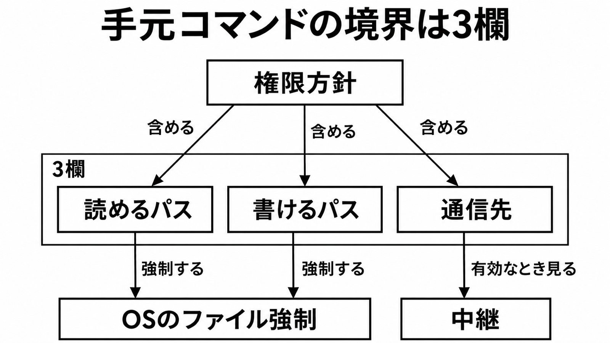

# ダイジェスト: Codexが隔離して起動するコマンドの3欄

[元記事](../../../../../articles/codex-openai-index-inside-p2_20261119.md)

## ひとことで言うと

Codexが自分のマシンで隔離して起動するコマンドは、読めるパス、書けるパス、通信先の3欄です。

## 核心ポイント

- Codex は、隔離するコマンドを名前付きの権限方針で起動します。子プロセスも、同じ制限を引き継ぎます。
- 通常は、作業フォルダへの書き込みと、その外の読み取りを同時に許します。その代わり、別の場所の秘密も読めます。
- 通信先の規則は、転送する仕組みが有効なときだけコマンドの宛先を見ます。
- 資格情報と権限を上げたコマンドは、3欄の外です。入出力でつなぐ外部ツールは、既定では外です。
- 同じ設定でも、制限の効き方は OS の実装ごとに違います。

## メンタルモデル

上の方針が、中央の枠にある3欄をまとめます。下の中継は宛先を検査して転送する仕組みで、通信先からの矢印の先です。

## 具体例

編集を止めるなら :read-only（書き込み停止）です。通常の作業は :workspace です。作業フォルダの外の秘密を拒むなら、公式例の workspace-only（外の秘密を拒否）です。

## 適用と判断

向く場面:

- 自分のマシンの Codex で、ファイルの範囲を決めます。
- 通信先をドメインで制限します。

確認すること:

- ネットワークを有効にするなら、転送する仕組みも有効ですか。

## 限界・注意点

- 書き込んだファイルを、あとから別の道具が欄の外で実行できます。
- Linux と Windows の一部では、読み取りの拒否は起動時に具体的なパスへ広がります。その後に増えたファイルは、そのプロセスでは拒否されません。
- Windows の実験的な転送は、テスト前には使いません。

## 参考

- 元記事: [codex-openai-index-inside-p2_20261119.md](../../../../../articles/codex-openai-index-inside-p2_20261119.md)
- [Inside the Codex sandbox](https://openai.com/index/inside-the-codex-sandbox)
- [Permissions](https://learn.chatgpt.com/codex/permissions.md)
- [Sandboxing](https://learn.chatgpt.com/codex/sandboxing.md)
- [Security cookbook](https://learn.chatgpt.com/codex/enterprise/security-cookbook.md)
