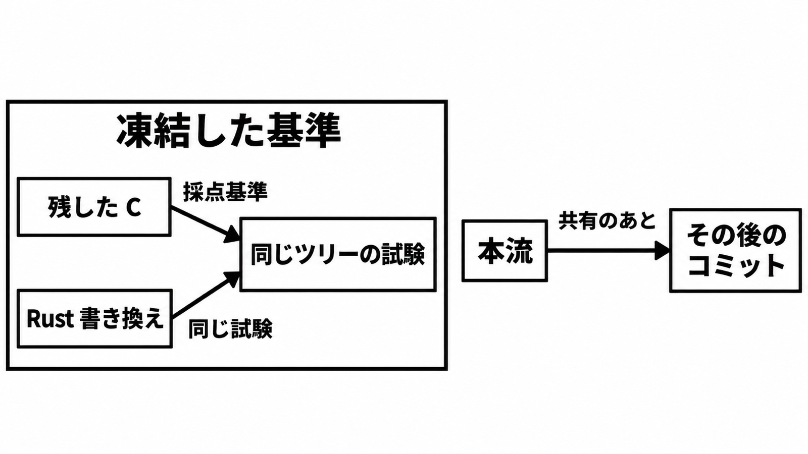

# ダイジェスト: curlのRust書き換えと、本流の並走の数え方

[元記事](../../../../../articles/curl-rust-300-simonwillison-p5_20261119.md)

## ひとことで言うと

curl の Rust 書き換えは、止めて残した C を試験の採点基準にします。

## 核心ポイント

- 書き換え側は、止めて残した C を試験の採点基準にします。動く本流は、追い続ける相手ではありません。
- 2026年11月19日時点で、書き換えだけのコミットが 2,379、本流だけのコミットが 366 です。
- 本流だけのコミット数は、欠けた修正の件数ではありません。
- 進捗は四つの欄で見ます。C と書き換えの両方で通った試験、本流だけのコミット、取り込み前のセキュリティ修正、差分の記録です。

## メンタルモデル

左の枠の試験は、止めて残した C と書き換えが同じ場所で使う試験です。右の矢印は、本流がその後のコミットを積む向きです。

## 具体例

本流だけの 366 件のうち 3 件は、書き換え側の差分の記録が同じ結果を既に書いています。

## 適用と判断

向く場面:

- 生きた本流を、全面的に移す計画を書きます。
- 進捗を、行数やコミット数だけで報告します。
- 今日の代替か、基準時点の写しかを決めます。

確認すること:

- 採点の基準を、日付とコミットで特定しましたか。
- 本流だけのコミットが上限を超えたら、見直しますか。
- 動作一致から外す試験を、名前で書きましたか。
- セキュリティを変える本流のコミットを、分けましたか。
- 今日の代替と呼ぶ期間を、決めましたか。

## 限界・注意点

- 2026年10月20日から11月17日までの公開アドバイザリは 0 件です。未公開の報告は見ていません。
- 試験が全部通る、という宣言は、再実行の結果ではありません。
- 3 件の差分の記録を、対応する本流のコミットより前に書いたかは、公開の記録では分かりません。

## 参考

- 元記事: [curl-rust-300-simonwillison-p5_20261119.md](../../../../../articles/curl-rust-300-simonwillison-p5_20261119.md)
- Daniel Stenberg, [Actual curl rewrites in rust](https://daniel.haxx.se/blog/2026/11/17/actual-curl-rewrites-in-rust/)
- Simon Willison, [引用ページ](https://simonwillison.net/2026/Nov/18/daniel-stenberg/)
- [compare（master と rust-rewrite）](https://github.com/curl/curl/compare/master...kov:rust-rewrite)
- [kov/curl](https://github.com/kov/curl)
