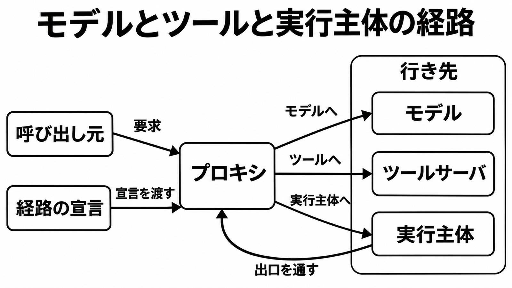

# ダイジェスト: モデルと使用量とツールをプロキシへ載せる

[元記事](../../../../../articles/envoy-mcp-cloud-google-products-p6_20261119.md)

## ひとことで言うと

Google Cloud は、モデルと使用量とツール経路を Envoy に載せると発表しました。

## 核心ポイント

- Agent Router が経路を宣言し、プロキシがモデル、ツールサーバ、エージェントの置き場へ分けます。
- 使用量の枠は、着いたときに、すでに課金した分だけを見ます。
- ツール呼び出しを拒めるのは、経路のルール、プロキシの認可、ツールサーバ、古い中継です。
- 世代の違うクライアントを両方受けるときだけ、版のヘッダで入口を分けます。
- エージェントの資格情報は、プロキシの出口で足します。

## メンタルモデル

左上は呼び出し元、左下の経路の宣言は Agent Router、中央がプロキシ、右の枠が行き先です。実行主体はエージェントの置き場で、戻り矢印はプロキシへ戻る向きです。

## 具体例

空の 1,000 トークンの時間枠へ入った要求が、1,200 トークンを流し切ります。その枠の次の要求から 429 になります。

## 適用と判断

向く場面:

- 設定変更でモデルの提供元を切り替えます。
- ツール名で呼び出しを止めます。
- 使っていないエージェントの置き場を共有します。

確認すること:

- 初回の長い要求を、モデルの前で止める手段が別にありますか。

## 限界・注意点

- Model Armor と ShieldGemma は、設定項目の名前としては未確認です。
- 会話の本文とツール引数はプロキシのアクセスログに無く、正本にするときは別に置きます。
- クォータを判定するサービスが無いとき、判定できない要求は通します。

## 参考

- 元記事: [envoy-mcp-cloud-google-products-p6_20261119.md](../../../../../articles/envoy-mcp-cloud-google-products-p6_20261119.md)
- [Building an agentic stack in Envoy](https://cloud.google.com/blog/products/networking/the-envoy-agentic-stack-routing-models-tokens-and-mcp/)
- [Agent Router](https://github.com/theagentrouter/agent-router)
- [MCP Streamable HTTP](https://modelcontextprotocol.io/specification/2026-07-28/basic/transports/streamable-http)
- [Agent Substrate](https://github.com/agent-substrate/substrate)
