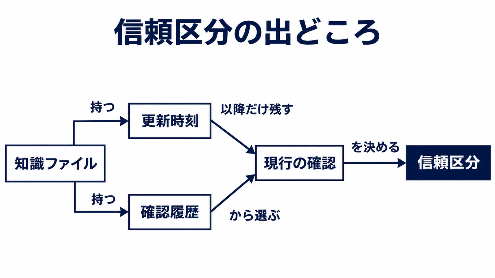

# ダイジェスト: OKF v0.3 の受け渡し

[元記事](../../../../../articles/google-okf-v0-cloud-google-p4_20261120.md)

## ひとことで言うと

Google の OKF v0.3（知識を渡す仕様）は、どの確認の記録を有効にするかを受け渡しに固定します。

## 核心ポイント

- 規範の本文は、open-knowledge-format の 2026-11-18 のコミットです。
- ブログが指す GoogleCloudPlatform の本文は、取得時点で v0.2 のままです。
- 信頼区分は、知識ファイル（種別付きの文書）の更新時刻以降の確認だけから計算します。
- 日付だけの確認は、その日の UTC 0時として比較されます。
- 受け取り検査は、空の欄と壊れたリンクを通します。

## メンタルモデル

左から、知識ファイル、更新時刻と確認履歴、現行の確認、信頼区分の順です。更新時刻があるときの並びです。

## 具体例

日付だけにしたコピーでは、人が確認済みが 5件から 0件になりました。日時を残した版は 5件のまま、書き手の件数と一致しました。v0.3 の比較式は、Google の公式測定ではない公開前の実験のこの減りを、仕様側で再現します。

## 適用と判断

向く場面:

- 複数の組織が同じ知識を編集します。
- エージェントが書き換えたら、その前の人の確認を区分から外したいときです。

確認すること:

- 組織間の合意文書に、2026-11-18 のコミットを書きましたか。
- ルート index.md の okf_version は 0.3 ですか。
- 別ファイルを指す欄を、先頭の / で書きましたか。
- 確認時刻を、オフセット付きの日時にしましたか。

## 限界・注意点

- 人を示すラベルは、本人確認ではありません。
- 更新時刻の意味は、生産者の判断です。
- 更新の記録が無いときは、残った確認を現行にします。
- 廃止したファイルが指す次のファイルが輪になるか欠けたとき、止まり方は仕様にありません。
- open-knowledge-format の Release は、取得時点で 0件です。

## 参考

- 元記事: [google-okf-v0-cloud-google-p4_20261120.md](../../../../../articles/google-okf-v0-cloud-google-p4_20261120.md)
- [Google Cloud Blog, What's new in OKF v0.3（datePublished 2026-11-19）](https://cloud.google.com/blog/products/data-analytics/introducing-okf-v0-3/)
- [OKF SPEC v0.3, commit 527e81aff55992be21507e97004286789126f88c（2026-11-18）](https://github.com/open-knowledge-format/open-knowledge-format/blob/527e81aff55992be21507e97004286789126f88c/SPEC.md)
- [旧組織の SPEC（取得時点で Version 0.2）](https://github.com/GoogleCloudPlatform/open-knowledge-format/blob/main/SPEC.md)
- [日付だけにした実験の記録（2026-10-02）](https://github.com/DavidROliverBA/ai-xf-format/blob/main/experiments/e9-knowledgex/e9-results.md)
